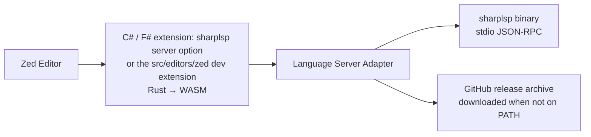
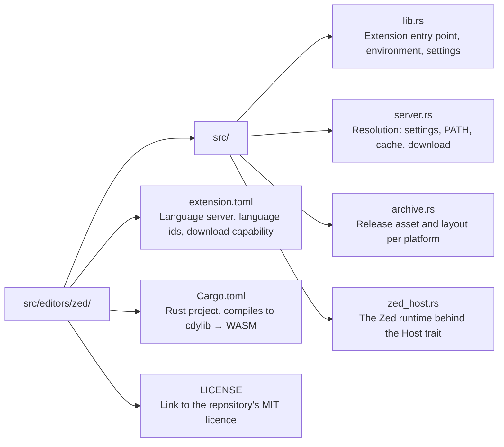

# Zed Extension Plan

**Status:** Active
**Last Updated:** 2026-10-17

## Overview

SharpLsp in Zed — the open-source .NET LSP. Starts the SharpLsp language server for C# and F# in Zed, downloading it when it is not installed. It ships as a server option inside the existing C# and F# Zed extensions, not as an extension of its own: the registry closes competing C# servers in favour of the existing extension. `src/editors/zed` is the reference implementation those changes port from and the dev extension that tests them ([DIST-ZED-REGISTRY]).

## Architecture



The extension compiles to WASM and runs in Zed's sandbox. It reads only its own work directory, where downloads unpack; everything else goes through the extension API.

## VS Code Feature Parity Matrix

| VS Code Feature | Zed Status | Implementation |
|----------------|------------|----------------|
| LSP client (C# + F#) | Done | `language_server_command()` in lib.rs |
| Server binary resolution | Done | `server::resolve`: settings path, PATH, cached or downloaded release |
| Server download | Done | Latest release's [DIST-ARCHIVE] asset, unpacked and made executable |
| Server environment (RUST_LOG) | Done | `server_env()`: shell env, `binary.env` overrides, `info` default |
| Server settings | Done | `lsp.sharplsp.settings` → `settings.sharplsp` client layer |
| Solution tree | Blocked | Requires Zed custom panel API (extension slash commands were removed from Zed) |
| Solution tree (symbol hierarchy) | Blocked | Requires Zed custom panel API |
| Solution tree (namespace merging) | Blocked | Requires Zed custom panel API |
| Solution tree (click-to-navigate) | Blocked | Requires Zed custom panel API |
| Solution tree (hover tooltips) | Blocked | Requires Zed custom panel API |
| Sort modes (natural/alpha/access) | Blocked | Requires Zed custom panel API |
| Status bar indicator | Blocked | Zed has no extension status bar API |
| Restart server command | N/A | Zed manages LSP lifecycle natively |
| Output/trace channels | N/A | Zed has built-in LSP log viewer |
| Select solution dialog | Blocked | Requires Zed modal UI API |
| Remove NuGet package | Blocked | Requires Zed command/UI API |
| Remove project reference | Blocked | Requires Zed command/UI API |
| Document symbols outline | Free | Zed outline panel + sharplsp documentSymbol |
| Semantic tokens | Free | Zed renders LSP semantic tokens natively |
| Auto-refresh on file change | Free | Zed re-queries LSP on file change |

### Zed Platform Limitations

Zed extensions (as of 2026-03) cannot:

1. **Create custom panels or tree views** — no equivalent to VS Code's `TreeDataProvider`
2. **Add status bar items** — no extension API for the status bar
3. **Register editor commands** — no command palette contributions from extensions
4. **Show dialogs/quick picks** — no modal UI from extensions
5. **Provide slash commands** — Zed removed extension slash commands; the registry no longer accepts them

These are tracked upstream: [zed-industries/extensions#1288](https://github.com/zed-industries/extensions/issues/1288)

When Zed adds custom panel support, the solution tree becomes a native panel.

## File Structure



## Building

```bash
# Native check (development)
cargo check --manifest-path src/editors/zed/Cargo.toml

# WASM build (release; Zed builds dev extensions for wasm32-wasip2 itself)
cargo build --manifest-path src/editors/zed/Cargo.toml --release --target wasm32-wasip2

# Run tests
cargo test --manifest-path src/editors/zed/Cargo.toml
```

Requires `rustup target add wasm32-wasip2` for WASM builds.

## Key Decisions

1. **Standalone workspace** — The Zed extension has its own `[workspace]` in Cargo.toml because it targets wasm32-wasip1, not the native target used by sharplsp.

2. **No grammar/highlights** — The extension does not bundle tree-sitter grammars or highlight queries. Users should install the existing C# Zed extension for syntax highlighting. SharpLsp provides the language server, not the grammar.

3. **No slash commands** — The `/sharplsp-tree` slash command was removed with Zed's extension slash-command API; the registry no longer accepts them.

4. **Upstream, not a registry extension** — The registry accepts one extension per functionality and closed C# Enhanced, csharp-ls and .NET submissions in favour of the existing C# extension. SharpLsp therefore ships inside `zed-extensions/csharp` and `nathanjcollins/zed-fsharp`. Both download the latest server release, so a SharpLsp release needs no extension update ([DIST-ZED-REGISTRY]).

## TODOs

### Phase 1: Core (Done)

- [x] Extension manifest (`extension.toml`)
- [x] Cargo project setup (standalone workspace, cdylib)
- [x] LSP server binary resolution (PATH lookup with caching)
- [x] Server environment configuration (RUST_LOG from shell env)
- [x] Attach to Zed's `CSharp` and `FSharp` languages (was `C#`/`F#`, which matched nothing)
- [x] Download the release archive when the server is not installed
- [x] Remove the `/sharplsp-tree` slash command (Zed removed extension slash commands)

### Phase 2: Settings and Configuration

- [x] `lsp.sharplsp.binary.path`, `.arguments` and `.env` from Zed settings
- [x] `lsp.sharplsp.settings` passed through as the server's client layer
- [ ] Send initialization options (solution path) to sharplsp

### Phase 3: Symbol Integration

- [ ] Custom symbol labels via `labels_for_symbols()`
- [ ] Custom completion labels via `labels_for_completions()`
- [ ] Enhanced outline display for .NET symbol kinds

### Phase 4: Zed Custom Panel (Blocked on Zed API)

- [ ] Solution tree as a native panel
- [ ] Click-to-navigate on symbol nodes
- [ ] Hover tooltips via LSP `textDocument/hover`
- [ ] Sort modes: natural, alphabetical, accessibility
- [ ] Namespace merging across files
- [ ] Dependency management (remove package/reference)
- [ ] Auto-refresh on C#/F# file changes (debounced)
- [ ] Status bar indicator (server state)

### Phase 5: Language Support (Not planned)

The C# and F# extensions own the grammars and language definitions, and
SharpLsp ships inside them as a server option ([DIST-ZED-REGISTRY]).

### Phase 6: Testing and CI

- [ ] E2E test harness (launch Zed with extension, open .sln workspace)
- [x] CI pipeline: `cargo test` with the coverage ratchet (`make _test-zed`)
- [x] CI pipeline: `cargo clippy` (`make _lint-zed`)
- [ ] WASM binary size optimization
- [x] No bundled server: resolve from settings or PATH, else download the release archive ([DIST-ZED-REGISTRY])

### Phase 7: Upstream Distribution

The registry closes competing C# server extensions, so SharpLsp ships inside the existing C# and F# extensions ([DIST-ZED-REGISTRY]).

- [ ] Test SharpLsp in Zed through the `src/editors/zed` dev extension
- [ ] PR to `zed-extensions/csharp`: a `sharplsp` server for `CSharp` beside OmniSharp, Roslyn and csharp-ls, with resolution and download ported from `src/editors/zed`
- [ ] PR to `nathanjcollins/zed-fsharp`: a `sharplsp` server for `FSharp` beside fsautocomplete, ported the same way
- [ ] Website: Zed install docs once either PR ships (`docs/editors.md`, plus `ja` and `zh`)

### Phase 8: Parity Polish

- [ ] Debugger integration (DAP support via Zed's debugger API)
- [ ] Snippet support for C# and F# common patterns
- [ ] MCP server integration for AI-powered .NET workflows
- [ ] Theme contributions (SharpLsp-branded dark/light themes), as a separate `-theme` extension: the registry requires one
