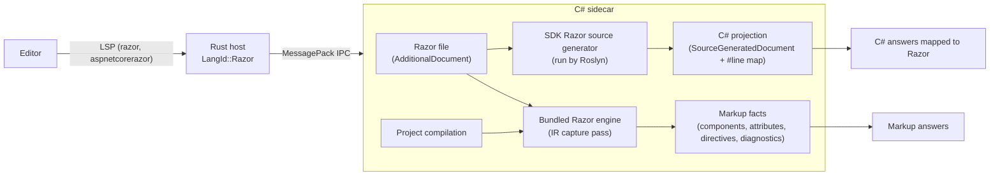

# [RAZOR-SPEC] Razor: Blazor Components, Razor Pages and MVC Views

**Parent:** [SHARPLSP-SPEC.md](SHARPLSP-SPEC.md) · **Plan:** [RAZOR-PLAN.md](../plans/RAZOR-PLAN.md)

## [RAZOR-OVERVIEW] Overview

SharpLsp edits Razor files with the same compiler-backed intelligence it gives C#. That covers `.razor` Blazor components, and `.cshtml` Razor Pages and MVC views.

Blazor support is complete, not a subset. Every component construct answers through the same features:

- **Constructs:** components and their parameters, generic components, child content, cascading values, event callbacks, two-way binding, directive attributes, render modes, and the C# inside all of them.
- **Features:** hover, navigation, completion, references, rename, diagnostics and highlighting.

Razor's semantics belong to the Razor compiler. SharpLsp never re-implements Razor parsing or code generation. It runs the compiler that ships in the .NET SDK and reads that compiler's public outputs.

## [RAZOR-SCOPE] Scope

### [RAZOR-SCOPE-VERSIONS] Versions

Only the latest release is supported: ASP.NET Core 10 on the .NET 10 SDK. Its projects compile Razor through the source generator at Razor language version 10.0, with the Roslyn tokenizer turned on.

- **net8.0 and net9.0:** these projects compile Razor through the same source generator, so they work too, but they are not verified.
- **Before net6.0:** these projects compile Razor without a source generator, so there is no C# projection ([RAZOR-ARCHITECTURE-PROJECTION]). They are out of scope.
- **Other out-of-scope tooling:** ASP.NET MVC 5 and Web Pages Razor on .NET Framework (`System.Web.Razor`), Web Forms (`.aspx`, `.ascx`) and Razor runtime compilation.

### [RAZOR-SCOPE-FILES] File Kinds

| File | Razor kind | Role |
|---|---|---|
| `*.razor` | Component | A Blazor component |
| `_Imports.razor` | Component import | `@using`, `@inject`, `@layout`, … applied to every component in its folder and below |
| `*.cshtml` | Legacy | A Razor Page (`@page`), MVC view, partial view or layout |
| `_ViewImports.cshtml` | Legacy import | Directives applied to every view and page in its folder and below |
| `_ViewStart.cshtml` | Legacy | The code that runs before each view |

The supported project SDKs are `Microsoft.NET.Sdk.Web`, `Microsoft.NET.Sdk.Razor` (Razor class libraries) and `Microsoft.NET.Sdk.BlazorWebAssembly`.

### [RAZOR-SCOPE-LANGUAGE] Code Language

Razor's code language is C#, because the Razor compiler generates only C#. [RAZOR-FSHARP] states what F# gets.

## [RAZOR-RESEARCH] How the Razor Toolchain Works

These findings come from research against SDK 10.0.303 in October 2026. They are the facts this design rests on.

1. **The compiler ships as a source generator.** It is `sdk/<version>/Sdks/Microsoft.NET.Sdk.Razor/source-generators/Microsoft.CodeAnalysis.Razor.Compiler.dll`, a netstandard2.0 Roslyn generator; SDK 10.0.303's copy is built against Roslyn 5.5. No current NuGet package carries it: `Microsoft.AspNetCore.Razor.Language` stops at 6.0.36, and `Microsoft.Net.Compilers.Razor.Toolset` only has a few old previews.
2. **A design-time build already runs it.** The SDK target `_PrepareRazorSourceGenerators` wires the generator in:
   - It adds the generator as an `Analyzer`.
   - It passes every Razor file as an `AdditionalFiles` item. Each item carries `TargetPath` metadata (base64-encoded) and `CssScope` metadata.
   - It exposes `RazorLangVersion`, `RootNamespace`, `SupportLocalizedComponentNames`, `GenerateRazorMetadataSourceChecksumAttributes` and `MSBuildProjectDirectory` as `build_property.*` analyzer options.
   - For net10.0 it adds `use-roslyn-tokenizer=true` to the C# parse options' `Features`.

   No switch suppresses the generator. A design-time build through `MSBuildWorkspace` gives a project whose compilation runs it, just as `dotnet build` does.
3. **Every C# fragment is mapped back to its Razor source.** Each Razor file gets one generated file, named after its target path, such as `Pages/Board_razor.g.cs`. That file opens with `#pragma checksum "<razor path>"`. The C# in each fragment is copied verbatim and wrapped in an enhanced `#line (line,col)-(line,col) [offset] "<razor path>"` directive:

   | Mapped to C# | Not mapped |
   |---|---|
   | `@using`, `@page` route, `@inherits`, `@implements`, `@inject` type and name, `@model`, `@typeparam`, `@rendermode`, `@attribute` | component tag names (`<Counter>`) |
   | implicit `@expr` and explicit `@(expr)` expressions | `@bind-X` and directive attribute names (`@onclick`) |
   | code blocks `@{ }`, control flow `@if/@foreach/…`, `@code` and `@functions` blocks | HTML, Razor comments, transitions |
   | component parameter names (as `nameof(Component.Param)`) and values | the `Changed`/setter half of `@bind` |
   | event handler expressions, `@ref` targets, `@key` values, generic type arguments | tag helper element and attribute names (`asp-for`) |
   | tag helper attribute values (`asp-for="Title"` → `__model => __model.Title`) | |

4. **Roslyn reads those directives through public APIs.** `SyntaxTree.GetLineMappings()` exposes each directive, and `Location.GetMappedLineSpan()` maps any generated location back to the Razor file. Roslyn reports a mapped span's end one character past the fragment, so SharpLsp measures each fragment by comparing the source text with the generated text instead.
5. **Roslyn's IDE services work on generated documents.** Completion, symbol lookup, references and classification all work on a `SourceGeneratedDocument`. A reference that Roslyn finds in generated code carries the Razor path through the mapping. A reference inside hidden scaffolding, such as `__builder` calls and `@bind` setters, has no mapped path.
6. **The compiler's public API covers what the C# mapping misses.**
   - **Public:** `RazorProjectEngine` and its configuration; parser options that list the directives active for a file kind; the intermediate representation (`Microsoft.AspNetCore.Razor.Language.Intermediate`); the `IntermediateNodePassBase` extension point; tag-helper descriptors; and `CompilationTagHelperFeature`.
   - **Internal:** the syntax tree nodes and the generated C# document.
   - **What the IR carries:** component tag names (`ComponentIntermediateNode.StartTagSpan`), attribute name spans (`OriginalAttributeSpan`), `@bind-X` pairs, elements, directives and Razor diagnostics.
7. **Microsoft's own tooling is not used.** Its Razor language server, now cohosted inside Roslyn's language server, depends on internal compiler APIs. SharpLsp reimplements from the public surface above ([SHARPLSP-MISSION-PRINCIPLES]).
8. **VS Code already knows Razor files.** It ships a built-in `razor` language for `.cshtml` and `.razor` with a TextMate grammar. HTML language features reach embedded HTML through request forwarding, as described in the VS Code guide [Embedded Programming Languages](https://code.visualstudio.com/api/language-extensions/embedded-languages).

## [RAZOR-ARCHITECTURE] Architecture



### [RAZOR-ARCHITECTURE-ROUTING] Host Routing

- **Ownership:** `.razor` and `.cshtml` URIs are `LangId::Razor`, and the C# sidecar owns them. It receives their `didOpen` and `didChange` text and their diagnostics pulls, and it answers every request about them.
- **Syntax requests:** for C#, the host answers `documentSymbol`, `foldingRange`, `selectionRange` and `linkedEditingRange` from tree-sitter. For a Razor file it forwards `documentSymbol`, `foldingRange` and `linkedEditingRange` to the sidecar instead, because the Razor compiler is the parser and no tree-sitter Razor grammar is trusted. `selectionRange` on a Razor file answers empty until it is implemented ([RAZOR-FEATURES-DEFERRED]).
- **Completion triggers:** the server adds `<` and `@` as completion triggers. A C# or F# document triggered by one of these two characters answers `null` at once, without reaching a sidecar.
- **Diagnostic source:** Razor diagnostics publish under the source `sharplsp-razor`.

### [RAZOR-ARCHITECTURE-DOCUMENTS] Razor Documents in the Workspace

- **Where a Razor file lives:** it is an `AdditionalDocument` of every project that lists it, with one copy per target framework.
- **Edits:** `didOpen` and `didChange` text replaces that additional document's text in every framework context, just as for C# documents ([NETFX-CONTEXT]). An edit that arrives before the workspace loads is replayed once it does.
- **Which context answers:** a Razor file answers from the project context that is active ([NETFX-PROJECTS-CSHARP]).
- **Unlisted files:** a Razor file that no project lists has no semantics, so every request about it answers empty.

### [RAZOR-ARCHITECTURE-PROJECTION] C# Projection

- **The projection:** a Razor file's projection is the generated document whose `#pragma checksum` names that file. `_Imports.razor` `@using` lines also appear in every component's generated document, but only `_Imports.razor`'s own generated document is its projection.
- **The map:** the map is built from the projection's line mappings whose path is the Razor file. Each entry pairs a Razor span with a generated span. Both spans hold the same text, and SharpLsp measures each one by comparing that text.
- **Razor to C#:** a Razor offset `o` is C# when some entry's Razor span contains `o` or ends at `o`. A caret just after `@curr` is C#, so completion works while typing. The generated offset is `generatedStart + (o − razorStart)`. When `o` ends one entry and starts the next, the entry that contains `o` wins.
- **C# to Razor:**
  - A location maps through `Location.GetMappedLineSpan()` when the result has a mapped path.
  - A location inside a projection with no mapped path is hidden scaffolding and is dropped.
  - There is one exception. The declaration of a component's own generated class maps to the start of its Razor file, because a component *is* its file.
- **Text edits:**
  - An edit computed on a projection maps back only when it lies entirely inside one entry.
  - An edit that adds a C# `using` becomes an `@using` line in the Razor file ([RAZOR-FEATURES-COMPLETION]).
  - Any other edit that cannot be mapped drops the item or action that carries it.

### [RAZOR-ARCHITECTURE-ENGINE] The Razor Engine

- **The bundled compiler:** SharpLsp bundles the Razor compiler assemblies from the SDK that builds it: `Microsoft.CodeAnalysis.Razor.Compiler`, `Microsoft.AspNetCore.Razor.Utilities.Shared` and `Microsoft.Extensions.ObjectPool`, all MIT-licensed.
- **Two compilers, two jobs:** the project's own SDK generator still produces the C# projection, so C# answers always match the user's build. The bundled engine reads markup structure only, and a newer or older SDK cannot break it.
- **Configuration:** each project's engine reads the same inputs the generator reads:
  - the analyzer options `build_property.RazorLangVersion`, `RootNamespace` and `SupportLocalizedComponentNames`;
  - the C# parse options: language version, preprocessor symbols and the `use-roslyn-tokenizer` feature;
  - each file's decoded `TargetPath`.
- **Features:**
  - `CompilerFeatures.Register` provides components;
  - MVC's `RazorExtensions.Register` provides pages, views and tag helpers;
  - tag helpers are discovered by `CompilationTagHelperFeature` over the project's compilation, generated components included, and over every reference of that compilation, project references included;
  - capture passes read the IR while the compiler builds it ([RAZOR-ARCHITECTURE-ENGINE-CAPTURE]).
- **File system:** the engine reads files through an in-memory Razor file system over the project's Razor documents. Imports therefore resolve as the compiler resolves them: the default imports, then hierarchical `_Imports.razor` or `_ViewImports.cshtml`, all from the workspace's current text.
- **Markup facts:** processing a file returns its markup facts ([RAZOR-ARCHITECTURE-ENGINE-FACTS]).
- **State lifetime:** tag helpers are compiler state derived from one Roslyn compilation, and they are held only as long as that compilation lives (keyed to its instance). They are never held per request, and they are never feature results ([SHARPLSP-ARCHITECTURE-CACHING]).

#### [RAZOR-ARCHITECTURE-ENGINE-CAPTURE] Capture Passes

Later passes rewrite the IR, so each capture pass copies what it needs the moment it runs:

| Pass | Runs | Reads |
|---|---|---|
| Directives | First in the directive-classifier phase, before `@code` becomes plain C# | Directives, `@using` included, and the HTML projection |
| Tags | First in the optimization phase, before components are lowered and attribute names lose their spans | Elements, attributes, and the namespaces `@using` imports |
| Diagnostics | Last in the optimization phase | `RZ` diagnostics |

- **Spans:** every span comes from the compiler. Where a node has no span for a part (an end tag's name, a directive's name, a directive attribute's `@`), the part's span is derived from the node's span and kept only when the text there is that part.
- **Imports:** directives and tags of imported files are skipped. A diagnostic is kept only when it lies in the processed file.

#### [RAZOR-ARCHITECTURE-ENGINE-FACTS] Markup Facts

```typediagram
typeDiagram

# A Razor file's markup facts, read from the compiler's IR.
type RazorMarkup {
  file_kind: RazorFileKind
  # The namespace the file's class is generated in.
  namespace: Option<String>
  # Namespaces the file and its imports bring in with `@using`.
  imported_namespaces: List<String>
  tags: List<MarkupTag>
  attributes: List<MarkupAttribute>
  directives: List<MarkupDirective>
  diagnostics: List<MarkupDiagnostic>
  # Directives the file kind accepts.
  available_directives: List<DirectiveDescriptor>
  # Every tag helper the project's compilation provides, components included.
  tag_helpers: List<TagHelperDescriptor>
  # The HTML projection ([RAZOR-ARCHITECTURE-HTML]).
  html_text: String
}

# An element bound to tag helpers, or any element of a component file.
type MarkupTag {
  name: String
  element: TextSpan
  start_name: TextSpan
  # Absent for a self-closing or unclosed element.
  end_name: Option<TextSpan>
  # The component, child content and MVC tag helpers bound to the element.
  tag_helpers: List<TagHelperDescriptor>
}

union MarkupAttributeKind {
  # A component parameter or tag helper property: `Title="…"`, `asp-for="…"`.
  Property
  # A directive attribute: `@onclick`, `@bind-Value`, `@ref`.
  Directive
  # A directive attribute parameter: `@bind:event`, `@onclick:preventDefault`.
  DirectiveParameter
  # An attribute no tag helper binds.
  Html
}

type MarkupAttribute {
  kind: MarkupAttributeKind
  name: String
  name_span: Option<TextSpan>
  owner: MarkupTag
  tag_helper: Option<TagHelperDescriptor>
  bound: Option<BoundAttributeDescriptor>
  parameter: Option<BoundAttributeParameterDescriptor>
}

# A directive the file declares: `@page`, `@inject`, `@code`, `@using`.
type MarkupDirective {
  name: String
  span: TextSpan
  name_span: TextSpan
  descriptor: Option<DirectiveDescriptor>
}

type MarkupDiagnostic {
  # The `RZ` code.
  id: String
  message: String
  severity: RazorDiagnosticSeverity
  span: TextSpan
}

# A span of the file's text in UTF-16 code units (Roslyn's `TextSpan`).
type TextSpan {
  start: Int
  length: Int
}

union RazorFileKind {
  # A `.razor` component.
  Component
  # An `_Imports.razor` file.
  ComponentImport
  # A `.cshtml` page, view or `_ViewImports.cshtml`.
  Legacy
}

union RazorDiagnosticSeverity {
  Warning
  Error
}

# The Razor compiler's descriptors, opaque here.
type TagHelperDescriptor {}
type BoundAttributeDescriptor {}
type BoundAttributeParameterDescriptor {}
type DirectiveDescriptor {}
```

The facts hold no C# fragment spans: C# positions come from the projection's map ([RAZOR-ARCHITECTURE-PROJECTION]).

### [RAZOR-ARCHITECTURE-HTML] HTML Projection

- **What it is:** the HTML projection is the Razor text with every non-HTML character replaced by a space, newlines kept, so offsets and positions are unchanged. The replaced characters are C# fragments with their transitions and delimiters, directives, and Razor comments.
- **HTML comments:** a component's IR drops HTML comments. The engine therefore parses a component a second time with component parsing off, which keeps each comment's `<!--` and `-->` tokens, and copies those comment spans back into the projection.
- **How it is served:** `sharplsp/razor/htmlProjection` (`{ textDocument }` → `{ text }`) returns the projection for the document's current text.
- **Markup context:** the server finds the markup context at a caret by running an HTML tokenizer over the projection. The tokenizer follows the WHATWG tokenizer states. The possible contexts are a tag name, an attribute name, an attribute value, or content.

## [RAZOR-FEATURES] Features

### [RAZOR-FEATURES-DIAGNOSTICS] Diagnostics

- **C#:** every diagnostic of the file's projection whose mapped path is the Razor file. Diagnostics in hidden scaffolding are dropped.
- **Razor:** the `RZ` diagnostics among the file's markup facts. Razor's error severity maps to LSP Error and its warning severity to LSP Warning.
- **Solution-wide:** `workspace/diagnostics/all` reports Razor files as well.

### [RAZOR-FEATURES-HOVER] Hover

| Position | Answer |
|---|---|
| C# fragment | The C# hover at the mapped position, with its range mapped |
| Component tag (start or end) | The component type's hover, ranged on the tag name |
| Component attribute, `@bind-X` | The bound parameter property's hover |
| Directive attribute (`@onclick`, `@bind`, `@key`, `@ref`, `@rendermode`, `@formname`, `@attributes`) | The descriptor's documentation |
| Directive name (`@page`, `@inject`, …) | The directive's description |
| MVC tag helper element or attribute | The tag helper type's or property's hover |
| HTML | Nothing from the server. Clients forward HTML ([RAZOR-FEATURES-HTML]) |

### [RAZOR-FEATURES-DEFINITION] Definition

- **C# symbols:** resolved as in C#, with every result mapped back.
- **Component tags, start or end:**
  - A component authored in Razor goes to its `.razor` file, plus any code-behind partial class.
  - A component from metadata goes to decompiled source ([DEFINITION-CSHARP]).
- **Component attributes and `@bind-X`:** go to the parameter property.
- **From C#:** `typeof(Counter)` or `new Counter()` also lands in `Counter.razor`, not in the generated file.

### [RAZOR-FEATURES-REFERENCES] References and Highlights

- **C# symbols:** references include every Razor usage through the projections, mapped back, with hidden scaffolding dropped and duplicates removed. This holds for requests from `.cs` files too.
- **Component types:** references also include every start and end tag that instantiates the component, in every Razor file of the solution.
- **Parameter properties:** references also include every `@bind-X` attribute that names the property.
- **Document highlights:** the same rules, kept to the file. On a component tag, the start and end tag names highlight together.

### [RAZOR-FEATURES-COMPLETION] Completion

| Context at the caret | Items |
|---|---|
| C# fragment, or the end of one | Roslyn completion at the mapped position. Edits are mapped back, and an added `using` becomes an `@using` line |
| After `<` in markup | Components in scope, each by its short name when its namespace is imported and by its full name otherwise, with documentation. Inside a component, its child-content parameters (`<ChildContent>`) |
| Attribute name in a component start tag | Parameters not yet set, with `[EditorRequired]` ones first and marked; `@bind-X` for each bindable pair; directive attributes |
| Attribute name in an element start tag | Directive attributes: `@on{event}`, `@bind`, `@bind-value`, `@key`, `@ref`, `@attributes`, `@rendermode`, `@formname` |
| `@bind:` and `@on{event}:` | Parameters: `event`, `format`, `culture`, `get`, `set`, `after`, `preventDefault`, `stopPropagation` |
| `@` at the start of a markup line | The directives active for the file kind, from the parser options |
| MVC element start tag | Tag helper attributes (`asp-for`, `asp-page`, …) |

The client adds HTML element and attribute names ([RAZOR-FEATURES-HTML]). The host's postfix templates (`.if`, `.foreach`, …) never apply in a Razor file, where the same text can be markup.

### [RAZOR-FEATURES-SIGNATURE-HELP] Signature Help

Signature help in a C# fragment is computed at the mapped position.

### [RAZOR-FEATURES-RENAME] Rename

- **C# symbols:**
  - C# documents take Roslyn's rename edits.
  - Each Razor usage takes an edit at its mapped span, and a declaration in an `@code` block is edited in the Razor file.
  - A `@bind-Old` attribute becomes `@bind-New`.
- **prepareRename:**
  - On a C# fragment it answers the mapped identifier range.
  - On markup it refuses with a message.
  - A component type is renamed by renaming its file, so prepareRename refuses on a component tag.
- **Cross-language:** renaming an F# symbol renames its Razor usages, and renaming a C# symbol from a Razor file renames its F# usages ([RAZOR-FSHARP], [RENAME-CROSSLANGUAGE]).

### [RAZOR-FEATURES-SEMANTIC-TOKENS] Semantic Tokens

- **C# fragments:** Roslyn's classification of the projection, mapped back.
- **Markup tokens:**
  - component and child-content tag names are `class`;
  - component attribute names are `property`;
  - directive attribute names (`@onclick`, `@bind-Value`) are `decorator`;
  - directive names (`@page`, `@code`) are `keyword`.
- **Everything else:** the client's TextMate grammar colors the rest.

### [RAZOR-FEATURES-STRUCTURE] Folding, Symbols and Linked Editing

- **Folding:** elements that span lines, `@code` and `@functions` blocks, C# code blocks, and `@section` blocks. A fold ends on the line before its last line, so the closing tag or brace stays visible.
- **Document symbols:**
  - directives (`@page`, `@inject`, `@code`, …) are `Key` symbols, named with their `@`;
  - elements bound to components or tag helpers are `Class` symbols, named by their tag;
  - symbols nest by containment, so a component inside another nests under it;
  - the methods, properties and fields declared in `@code` and `@functions` nest under their block, and an `@inject` property under its directive.
- **Linked editing:** the start and end tag names of a component, a tag helper element, or any element of a component file. A plain HTML element of a `.cshtml` file is not an element in the compiler's IR, so it does not link.

### [RAZOR-FEATURES-HTML] HTML in Editors

- **VS Code:** completion and hover in markup are forwarded to the built-in HTML language service over the HTML projection, following VS Code's request-forwarding pattern. The server's items come first and the HTML service's items are appended. Hover uses the HTML service only when the server has no answer.
- **Other editors:** they attach their own HTML language server to `razor` files.

### [RAZOR-FEATURES-DEFERRED] Not Yet Supported

- **Editing features:** formatting; selection ranges; code actions (extract a block to code-behind, extract a component, generate an event handler, add `@using`); inlay hints; code lens; call and type hierarchy from Razor positions.
- **Collocated files:** awareness of `.razor.css` CSS isolation and `.razor.js` collocated JavaScript.
- **Runtime features:** Blazor WebAssembly debugging and Razor Hot Reload.

Each of these is a separate plan item.

## [RAZOR-BLAZOR] Blazor Coverage

| Construct | Hover | Definition | Completion | References / rename | Diagnostics |
|---|---|---|---|---|---|
| `<Component>` tags | ✓ | ✓ | ✓ | ✓ / file rename | RZ10012 unknown element |
| Parameters (`Param="…"`) | ✓ | ✓ | ✓ | ✓ / ✓ | RZ2012 missing `[EditorRequired]` |
| Parameter values, event handlers, lambdas | ✓ (C#) | ✓ | ✓ | ✓ / ✓ | C# |
| Generic components (`@typeparam`, `TItem="int"`) | ✓ | ✓ | ✓ | ✓ / ✓ | C# |
| `@bind`, `@bind-X`, `@bind:event/format/get/set/after` | ✓ | ✓ | ✓ | ✓ / ✓ | RZ |
| `@on{event}`, `:preventDefault`, `:stopPropagation` | ✓ | — | ✓ | — | RZ |
| `@key`, `@ref`, `@attributes`, `@rendermode`, `@formname` | ✓ | ✓ (C# value) | ✓ | ✓ (C# value) | RZ |
| Child content, `RenderFragment<T>`, `Context=` | ✓ | ✓ | ✓ | ✓ | C# |
| Cascading values and parameters | ✓ (C#) | ✓ | ✓ | ✓ / ✓ | C# |
| Directives (`@page`, `@using`, `@inject`, `@inherits`, `@implements`, `@layout`, `@attribute`, `@namespace`, `@preservewhitespace`, `@rendermode`, `@typeparam`, `@code`) | ✓ | ✓ (C# tokens) | ✓ | ✓ (C# tokens) | RZ |
| `_Imports.razor` | ✓ | ✓ | ✓ | ✓ | C# |
| Code-behind partial classes (`.razor.cs`) | ✓ | ✓ | ✓ | ✓ / ✓ | C# |
| Razor class libraries | ✓ | ✓ | ✓ | ✓ | C# |

## [RAZOR-MVC] Razor Pages and MVC Views

- **Directives:** `@page`, `@model`, `@inject`, `@inherits`, `@functions`, `@section`, `@namespace`, `@addTagHelper`, `@removeTagHelper` and `@tagHelperPrefix` follow the directive rows above. `@model`'s type is C#, and so is `Model.X`.
- **Tag helpers:** a tag helper element or attribute (`<partial>`, `asp-for`, `asp-page`, `asp-route-*`) answers hover and completion from its descriptor. An `asp-for` value is a model expression, so it gets C# features.
- **Imports:** `_ViewImports.cshtml` is an import. `_ViewStart.cshtml`, layouts and partials are ordinary legacy files.

## [RAZOR-FSHARP] F# in Razor Solutions

Blazor front ends often sit over F# domain libraries. A Razor project that references an F# project reads it as its built DLL, like any C# project does ([DEFINITION-CROSSLANG]).

- **Hover, completion and signature help:** these work on F# types and members used in Razor through that metadata.
- **Definition:** definition on an F# symbol from Razor lands where it lands from C#: in decompiled metadata-as-source for the symbol's type ([DEFINITION-CROSSLANG]).
- **Rename from F#:** renaming an F# symbol renames its Razor usages too. The Rust host asks the C# sidecar for the C# usages of the symbol ([RENAME-CROSSLANGUAGE]). Those usages include the projections, and each one is mapped back to its Razor file, never edited in generated code.
- **References from F#:** references that start in F# reach C# and Razor usages only where they reach C# usages today ([DEFINITION-CROSSLANG]).
- **No F# Razor:** F# is not a Razor code language. A Razor `@code` block is C#.

## [RAZOR-EDITORS] Editors

- **VS Code:**
  - The client syncs `razor` documents (VS Code's built-in id) and `aspnetcorerazor` documents (the C# extension's id).
  - The extension activates on `onLanguage:razor`.
  - It forwards HTML requests ([RAZOR-FEATURES-HTML]).
- **Zed:** Zed has no built-in Razor language. The server attaches to `Razor`, the language community Razor extensions define, with language id `razor` ([DIST-ZED-REGISTRY]).
- **Other LSP clients:** the language id is `razor`, and the file types are `.razor` and `.cshtml`.

## [RAZOR-ERRORS] Degradation

- **Engine unavailable:** if the bundled engine fails to load or to process a file, markup features answer empty and the C# projection features keep working. The failure is logged once per project, with the project name and the exception type.
- **No projection:** a file whose project does not run the generator has no projection, so its C# features answer empty. Its markup facts still answer.
- **Nothing at the position:** a position that is neither in a C# fragment nor on a markup fact answers `null` or an empty list, never an error.
- **No content logged:** no Razor or generated text is ever logged. Logs carry only paths, spans and lengths.

## [RAZOR-TESTING] Tests

- **Fixture:** `src/sharplsp/tests/fixtures/razor/RazorFixtures.slnx` is a real solution of net10.0 projects, all of them buildable offline:

  | Project | What it is |
  |---|---|
  | `BlazorApp` | Components, generic components, binding, code-behind |
  | `Widgets` | A Razor class library used by `BlazorApp` |
  | `PagesApp` | Razor Pages, an MVC view and tag helpers |
  | `Domain` | An F# library used by `BlazorApp` |

  The C# projects use framework references only. `Domain` restores only `FSharp.Core`, from the local NuGet cache in CI as every F# fixture does. The folder's own `Directory.Build.props` and `Directory.Build.targets` shield it from the repository's build settings.
- **Sidecar tests:**
  - map unit tests over real generator output;
  - engine facts;
  - every feature in [RAZOR-FEATURES] against the fixture.
- **Rust end-to-end tests:** the full stack over the fixture: open, edit, diagnostics, hover, definition, references, completion and rename.
- **VS Code end-to-end tests:** a `razor` chunk that drives the real extension through the same features, including HTML forwarding.
