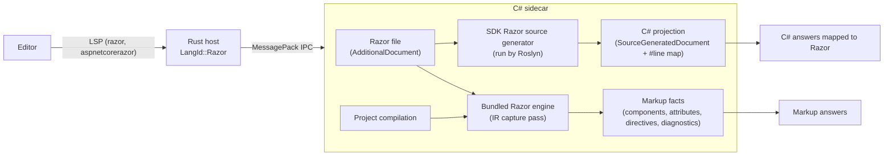

# [RAZOR-SPEC] Razor: Blazor Components, Razor Pages and MVC Views

**Parent:** [SHARPLSP-SPEC.md](SHARPLSP-SPEC.md)

## [RAZOR-OVERVIEW] Overview

SharpLsp edits Razor files with the same compiler-backed intelligence it gives C#. That covers `.razor` Blazor components, and `.cshtml` Razor Pages and MVC views.

Blazor support is complete, not a subset. Every component construct answers through the same features:

- **Constructs:** components and their parameters, generic components, child content, cascading values, event callbacks, two-way binding, directive attributes, render modes, and the C# inside all of them.
- **Features:** hover, navigation, completion, references, rename, diagnostics and highlighting.

Razor's semantics belong to the Razor compiler. SharpLsp never re-implements Razor parsing or code generation. It runs the compiler that ships in the .NET SDK and reads that compiler's public outputs.

## [RAZOR-SCOPE] Scope

### [RAZOR-SCOPE-VERSIONS] Versions

Only the latest release is supported: ASP.NET Core 10 on the .NET 10 SDK. Its projects compile Razor through the source generator at Razor language version 10.0, with the Roslyn tokenizer turned on.

- **net8.0 and net9.0:** these projects compile Razor through the same source generator, so they work too, but they are not verified.
- **Before net6.0:** these projects compile Razor without a source generator, so there is no C# projection ([RAZOR-ARCHITECTURE-PROJECTION]). They are out of scope.
- **Other out-of-scope tooling:** ASP.NET MVC 5 and Web Pages Razor on .NET Framework (`System.Web.Razor`), Web Forms (`.aspx`, `.ascx`) and Razor runtime compilation.

### [RAZOR-SCOPE-FILES] File Kinds

| File | Razor kind | Role |
|---|---|---|
| `*.razor` | Component | A Blazor component |
| `_Imports.razor` | Component import | `@using`, `@inject`, `@layout`, … applied to every component in its folder and below |
| `*.cshtml` | Legacy | A Razor Page (`@page`), MVC view, partial view or layout |
| `_ViewImports.cshtml` | Legacy import | Directives applied to every view and page in its folder and below |
| `_ViewStart.cshtml` | Legacy | The code that runs before each view |

The supported project SDKs are `Microsoft.NET.Sdk.Web`, `Microsoft.NET.Sdk.Razor` (Razor class libraries) and `Microsoft.NET.Sdk.BlazorWebAssembly`.

### [RAZOR-SCOPE-LANGUAGE] Code Language

Razor's code language is C#, because the Razor compiler generates only C#. [RAZOR-FSHARP] states what F# gets.

### [RAZOR-SCOPE-FORMATTING] Formatting

SharpLsp formats no language ([SHARPLSP-FEATURES-FORMATTING]), so Razor files get no formatting either. The server advertises no formatting capability, and an editor's own Razor formatter, if it has one, stays in charge.

## [RAZOR-RESEARCH] How the Razor Toolchain Works

These findings come from research against SDK 10.0.303 in October 2026. They are the facts this design rests on.

1. **The compiler ships as a source generator.** It is `sdk/<version>/Sdks/Microsoft.NET.Sdk.Razor/source-generators/Microsoft.CodeAnalysis.Razor.Compiler.dll`, a netstandard2.0 Roslyn generator; SDK 10.0.303's copy is built against Roslyn 5.5. No current NuGet package carries it: `Microsoft.AspNetCore.Razor.Language` stops at 6.0.36, and `Microsoft.Net.Compilers.Razor.Toolset` only has a few old previews.
2. **A design-time build already runs it.** The SDK target `_PrepareRazorSourceGenerators` wires the generator in:
   - It adds the generator as an `Analyzer`.
   - It passes every Razor file as an `AdditionalFiles` item. Each item carries `TargetPath` metadata (base64-encoded) and `CssScope` metadata.
   - It exposes `RazorLangVersion`, `RootNamespace`, `SupportLocalizedComponentNames`, `GenerateRazorMetadataSourceChecksumAttributes` and `MSBuildProjectDirectory` as `build_property.*` analyzer options.
   - For net10.0 it adds `use-roslyn-tokenizer=true` to the C# parse options' `Features`.

   No switch suppresses the generator. A design-time build through `MSBuildWorkspace` gives a project whose compilation runs it, just as `dotnet build` does.
3. **Every C# fragment is mapped back to its Razor source.** Each Razor file gets one generated file, named after its target path, such as `Pages/Board_razor.g.cs`. That file opens with `#pragma checksum "<razor path>"`. The C# in each fragment is copied verbatim and wrapped in an enhanced `#line (line,col)-(line,col) [offset] "<razor path>"` directive:

   | Mapped to C# | Not mapped |
   |---|---|
   | `@using`, `@page` route, `@inherits`, `@implements`, `@inject` type and name, `@model`, `@typeparam`, `@rendermode`, `@attribute` | component tag names (`<Counter>`) |
   | implicit `@expr` and explicit `@(expr)` expressions | `@bind-X` and directive attribute names (`@onclick`) |
   | code blocks `@{ }`, control flow `@if/@foreach/…`, `@code` and `@functions` blocks | HTML, Razor comments, transitions |
   | component parameter names (as `nameof(Component.Param)`) and values | the `Changed`/setter half of `@bind` |
   | event handler expressions, `@ref` targets, `@key` values, generic type arguments | tag helper element and attribute names (`asp-for`) |
   | tag helper attribute values (`asp-for="Title"` → `__model => __model.Title`) | |

4. **Roslyn reads those directives through public APIs.** `SyntaxTree.GetLineMappings()` exposes each directive, and `Location.GetMappedLineSpan()` maps any generated location back to the Razor file. Roslyn reports a mapped span's end one character past the fragment, so SharpLsp measures each fragment by comparing the source text with the generated text instead.
5. **Roslyn's IDE services work on generated documents.** Completion, symbol lookup, references and classification all work on a `SourceGeneratedDocument`. A reference that Roslyn finds in generated code carries the Razor path through the mapping. A reference inside hidden scaffolding, such as `__builder` calls and `@bind` setters, has no mapped path.
6. **The compiler's public API covers what the C# mapping misses.**
   - **Public:** `RazorProjectEngine` and its configuration; parser options that list the directives active for a file kind; the intermediate representation (`Microsoft.AspNetCore.Razor.Language.Intermediate`); the `IntermediateNodePassBase` extension point; tag-helper descriptors; and `CompilationTagHelperFeature`.
   - **Internal:** the syntax tree nodes and the generated C# document.
   - **What the IR carries:** component tag names (`ComponentIntermediateNode.StartTagSpan`), attribute name spans (`OriginalAttributeSpan`), `@bind-X` pairs, elements, directives and Razor diagnostics.
7. **Microsoft's own tooling is not used.** Its Razor language server, now cohosted inside Roslyn's language server, depends on internal compiler APIs. SharpLsp reimplements from the public surface above ([SHARPLSP-MISSION-PRINCIPLES]).
8. **VS Code already knows Razor files.** It ships a built-in `razor` language for `.cshtml` and `.razor` with a TextMate grammar. HTML language features reach embedded HTML through request forwarding, as described in the VS Code guide [Embedded Programming Languages](https://code.visualstudio.com/api/language-extensions/embedded-languages).

## [RAZOR-ARCHITECTURE] Architecture



### [RAZOR-ARCHITECTURE-ROUTING] Host Routing

- **Ownership:** `.razor` and `.cshtml` URIs are `LangId::Razor`, and the C# sidecar owns them. It receives their `didOpen` and `didChange` text and their diagnostics pulls, and it answers every request about them.
- **Syntax requests:** for C#, the host answers `documentSymbol`, `foldingRange`, `selectionRange` and `linkedEditingRange` from tree-sitter. For a Razor file it forwards all four to the sidecar instead, because the Razor compiler is the parser and no tree-sitter Razor grammar is trusted ([RAZOR-FEATURES-STRUCTURE], [RAZOR-FEATURES-SELECTION]).
- **Completion triggers:** the server adds `<` and `@` as completion triggers. A C# or F# document triggered by one of these two characters answers `null` at once, without reaching a sidecar.
- **Diagnostic source:** Razor diagnostics publish under the source `sharplsp-razor`.

### [RAZOR-ARCHITECTURE-DOCUMENTS] Razor Documents in the Workspace

- **Where a Razor file lives:** it is an `AdditionalDocument` of every project that lists it, with one copy per target framework.
- **Edits:** `didOpen` and `didChange` text replaces that additional document's text in every framework context, just as for C# documents ([NETFX-CONTEXT]). An edit that arrives before the workspace loads is replayed once it does.
- **Which context answers:** a Razor file answers from the project context that is active ([NETFX-PROJECTS-CSHARP]).
- **Unlisted files:** a Razor file that no project lists has no semantics, so every request about it answers empty.

### [RAZOR-ARCHITECTURE-PROJECTION] C# Projection

- **The projection:** a Razor file's projection is the generated document whose `#pragma checksum` names that file. `_Imports.razor` `@using` lines also appear in every component's generated document, but only `_Imports.razor`'s own generated document is its projection.
- **The map:** the map is built from the projection's line mappings whose path is the Razor file. Each entry pairs a Razor span with a generated span. Both spans hold the same text, and SharpLsp measures each one by comparing that text.
- **Razor to C#:** a Razor offset `o` is C# when some entry's Razor span contains `o` or ends at `o`. A caret just after `@curr` is C#, so completion works while typing. The generated offset is `generatedStart + (o − razorStart)`. When `o` ends one entry and starts the next, the entry that contains `o` wins.
- **C# to Razor:**
  - A location maps through `Location.GetMappedLineSpan()` when the result has a mapped path.
  - A location inside a projection with no mapped path is hidden scaffolding and is dropped.
  - There is one exception. The declaration of a component's own generated class maps to the start of its Razor file, because a component *is* its file.
- **Text edits:**
  - An edit computed on a projection maps back only when it lies entirely inside one entry.
  - An edit that adds a C# `using` becomes an `@using` line in the Razor file ([RAZOR-FEATURES-COMPLETION]).
  - Any other edit that cannot be mapped drops the item or action that carries it.

### [RAZOR-ARCHITECTURE-GENERATOR] Generator Compatibility

- The project's Razor source generator must run against the Roslyn version loaded by the sidecar.
- When the project's Razor compiler references a newer `Microsoft.CodeAnalysis` assembly than the sidecar runs, project loading replaces that compiler and its sibling dependencies with the bundled copies before the SDK compiler can load.
- The bundled compiler is loaded first: once the newer SDK compiler is loaded, Roslyn cannot replace it for that session.
- A structured warning identifies the SDK compiler's required Roslyn version and the sidecar's Roslyn version when replacement is necessary.
- The project's source-generated components remain available to ordinary C# files and Razor projection queries. End-to-end tests restore a real fixture without the repository SDK pin, then verify Razor hover and component references from C# ([RAZOR-TESTING]).

### [RAZOR-ARCHITECTURE-ENGINE] The Razor Engine

- **The bundled compiler:** SharpLsp bundles the Razor compiler assemblies from the SDK that builds it: `Microsoft.CodeAnalysis.Razor.Compiler`, `Microsoft.AspNetCore.Razor.Utilities.Shared` and `Microsoft.Extensions.ObjectPool`, all MIT-licensed.
- **Two compilers, two jobs:** the project's own SDK generator still produces the C# projection, so C# answers always match the user's build. The bundled engine reads markup structure only, and a newer or older SDK cannot break it.
- **Configuration:** each project's engine reads the same inputs the generator reads:
  - the analyzer options `build_property.RazorLangVersion`, `RootNamespace` and `SupportLocalizedComponentNames`;
  - the C# parse options: language version, preprocessor symbols and the `use-roslyn-tokenizer` feature;
  - each file's decoded `TargetPath`.
- **Features:**
  - `CompilerFeatures.Register` provides components;
  - MVC's `RazorExtensions.Register` provides pages, views and tag helpers;
  - tag helpers are discovered by `CompilationTagHelperFeature` over the project's compilation, generated components included, and over every reference of that compilation, project references included;
  - capture passes read the IR while the compiler builds it ([RAZOR-ARCHITECTURE-ENGINE-CAPTURE]).
- **File system:** the engine reads files through an in-memory Razor file system over the project's Razor documents. Imports therefore resolve as the compiler resolves them: the default imports, then hierarchical `_Imports.razor` or `_ViewImports.cshtml`, all from the workspace's current text.
- **Markup facts:** processing a file returns its markup facts ([RAZOR-ARCHITECTURE-ENGINE-FACTS]).
- **State lifetime:** tag helpers are compiler state derived from one Roslyn compilation, and they are held only as long as that compilation lives (keyed to its instance). They are never held per request, and they are never feature results ([SHARPLSP-ARCHITECTURE-CACHING]).

#### [RAZOR-ARCHITECTURE-ENGINE-CAPTURE] Capture Passes

Later passes rewrite the IR, so each capture pass copies what it needs the moment it runs:

| Pass | Runs | Reads |
|---|---|---|
| Directives | First in the directive-classifier phase, before `@code` becomes plain C# | Directives, `@using` included, and the HTML projection |
| Tags | First in the optimization phase, before components are lowered and attribute names lose their spans | Elements, attributes, and the namespaces `@using` imports |
| Diagnostics | Last in the optimization phase | `RZ` diagnostics |

- **Spans:** every span comes from the compiler. Where a node has no span for a part (an end tag's name, a directive's name, a directive attribute's `@`), the part's span is derived from the node's span and kept only when the text there is that part.
- **Imports:** directives and tags of imported files are skipped. A diagnostic is kept only when it lies in the processed file.

#### [RAZOR-ARCHITECTURE-ENGINE-FACTS] Markup Facts

```typediagram
typeDiagram

# A Razor file's markup facts, read from the compiler's IR.
type RazorMarkup {
  file_kind: RazorFileKind
  # The namespace the file's class is generated in.
  namespace: Option<String>
  # Namespaces the file and its imports bring in with `@using`.
  imported_namespaces: List<String>
  tags: List<MarkupTag>
  attributes: List<MarkupAttribute>
  directives: List<MarkupDirective>
  diagnostics: List<MarkupDiagnostic>
  # Directives the file kind accepts.
  available_directives: List<DirectiveDescriptor>
  # Every tag helper the project's compilation provides, components included.
  tag_helpers: List<TagHelperDescriptor>
  # The HTML projection ([RAZOR-ARCHITECTURE-HTML]).
  html_text: String
  # The C# code blocks (`@{ … }`) of the file.
  code_blocks: List<TextSpan>
  # The MVC tag helpers the file's directives bring into scope ([RAZOR-MVC-SCOPE]).
  scope: RazorTagHelperScope
}

# The tag helpers `@addTagHelper`, `@removeTagHelper` and `@tagHelperPrefix` leave in scope.
type RazorTagHelperScope {
  # The `@tagHelperPrefix` an element must carry; empty when the file sets none.
  prefix: String
  tag_helpers: List<TagHelperDescriptor>
}

# An element bound to tag helpers, or any element of a component file.
type MarkupTag {
  name: String
  element: TextSpan
  start_name: TextSpan
  # Absent for a self-closing or unclosed element.
  end_name: Option<TextSpan>
  # The component, child content and MVC tag helpers bound to the element.
  tag_helpers: List<TagHelperDescriptor>
}

union MarkupAttributeKind {
  # A component parameter or tag helper property: `Title="…"`, `asp-for="…"`.
  Property
  # A directive attribute: `@onclick`, `@bind-Value`, `@ref`.
  Directive
  # A directive attribute parameter: `@bind:event`, `@onclick:preventDefault`.
  DirectiveParameter
  # An attribute no tag helper binds.
  Html
}

type MarkupAttribute {
  kind: MarkupAttributeKind
  name: String
  name_span: Option<TextSpan>
  # Where the attribute ends — its value and closing quote, or a minimized
  # attribute's name — as the compiler's spans say.
  end: Option<Int>
  owner: MarkupTag
  tag_helper: Option<TagHelperDescriptor>
  bound: Option<BoundAttributeDescriptor>
  parameter: Option<BoundAttributeParameterDescriptor>
}

# A directive the file declares: `@page`, `@inject`, `@code`, `@using`.
type MarkupDirective {
  name: String
  span: TextSpan
  name_span: TextSpan
  descriptor: Option<DirectiveDescriptor>
}

type MarkupDiagnostic {
  # The `RZ` code.
  id: String
  message: String
  severity: RazorDiagnosticSeverity
  span: TextSpan
}

# A span of the file's text in UTF-16 code units (Roslyn's `TextSpan`).
type TextSpan {
  start: Int
  length: Int
}

union RazorFileKind {
  # A `.razor` component.
  Component
  # An `_Imports.razor` file.
  ComponentImport
  # A `.cshtml` page, view or `_ViewImports.cshtml`.
  Legacy
}

union RazorDiagnosticSeverity {
  Warning
  Error
}

# The Razor compiler's descriptors, opaque here.
type TagHelperDescriptor {}
type BoundAttributeDescriptor {}
type BoundAttributeParameterDescriptor {}
type DirectiveDescriptor {}
```

The facts hold no C# fragment spans: C# positions come from the projection's map ([RAZOR-ARCHITECTURE-PROJECTION]).

### [RAZOR-ARCHITECTURE-HTML] HTML Projection

- **What it is:** the HTML projection is the Razor text with every non-HTML character replaced by a space, newlines kept, so offsets and positions are unchanged. The replaced characters are C# fragments with their transitions and delimiters, directives, and Razor comments.
- **HTML comments:** a component's IR drops HTML comments. The engine therefore parses a component a second time with component parsing off, which keeps each comment's `<!--` and `-->` tokens, and copies those comment spans back into the projection.
- **How it is served:** `sharplsp/razor/htmlProjection` (`{ textDocument, position? }` → `{ text } | null`) returns the projection for the document's current text. With a caret, it returns `null` for compiler-backed C# positions, including whitespace and incomplete expressions recovered for completion. Compiler markup name facts take precedence: component tag and attribute names remain markup even when they also have C# mappings. Without a caret, it returns the whole projection.
- **Markup context:** the server finds the markup context at a caret by running an HTML tokenizer over the projection. The tokenizer follows the WHATWG tokenizer states. The possible contexts are a tag name, an attribute name, an attribute value, or content.

## [RAZOR-FEATURES] Features

### [RAZOR-FEATURES-DIAGNOSTICS] Diagnostics

- **C#:** every diagnostic of the file's projection whose mapped path is the Razor file. Diagnostics in hidden scaffolding are dropped. A Razor file never calls a using unnecessary (`CS8019`, `IDE0005`), because Roslyn sees only the projection. Markup resolves component tags through usings that the generated C# never needs, since it names each component in full. An import file's (`_Imports.razor`, `_ViewImports.cshtml`) usings serve the files beside and below it.
- **Razor:** the `RZ` diagnostics among the file's markup facts. Razor's error severity maps to LSP Error and its warning severity to LSP Warning.
- **Solution-wide:** `workspace/diagnostics/all` reports Razor files as well.

### [RAZOR-FEATURES-HOVER] Hover

| Position | Answer |
|---|---|
| C# fragment | The C# hover at the mapped position, with its range mapped |
| Component tag (start or end) | The component type's hover, ranged on the tag name |
| Component attribute, `@bind-X` | The bound parameter property's hover |
| Directive attribute (`@onclick`, `@bind`, `@key`, `@ref`, `@rendermode`, `@formname`, `@attributes`) | The descriptor's documentation |
| Directive name (`@page`, `@inject`, …) | The directive's description |
| MVC tag helper element or attribute | The tag helper type's or property's hover |
| HTML | Nothing from the server. Clients forward HTML ([RAZOR-FEATURES-HTML]) |

### [RAZOR-FEATURES-DEFINITION] Definition

- **C# symbols:** resolved as in C#, with every result mapped back.
- **Component tags, start or end:**
  - A component authored in Razor goes to its `.razor` file, plus any code-behind partial class.
  - A component from metadata goes to decompiled source ([DEFINITION-CSHARP]).
- **Component attributes and `@bind-X`:** go to the parameter property.
- **From C#:** `typeof(Counter)` or `new Counter()` also lands in `Counter.razor`, not in the generated file.

### [RAZOR-FEATURES-REFERENCES] References and Highlights

- **C# symbols:** references include every Razor usage through the projections, mapped back, with hidden scaffolding dropped and duplicates removed. This holds for requests from `.cs` files too.
- **Component types:** references also include every start and end tag that instantiates the component, in every Razor file of the solution.
- **Parameter properties:** references also include every `@bind-X` attribute that names the property.
- **Document highlights:** the same rules, kept to the file. On a component tag, the start and end tag names highlight together.

### [RAZOR-FEATURES-COMPLETION] Completion

| Context at the caret | Items |
|---|---|
| C# fragment, or the end of one | Roslyn completion at the mapped position. Edits are mapped back, and an added `using` becomes an `@using` line |
| After `<` in markup | Components in scope, each by its short name when its namespace is imported and by its full name otherwise, with documentation. Inside a component, its child-content parameters (`<ChildContent>`) |
| Attribute name in a component start tag | Parameters not yet set, with `[EditorRequired]` ones first and marked; `@bind-X` for each bindable pair; directive attributes |
| Attribute name in an element start tag | Directive attributes: `@on{event}`, `@bind`, `@bind-value`, `@key`, `@ref`, `@attributes`, `@rendermode`, `@formname` |
| `@bind:` and `@on{event}:` | Parameters: `event`, `format`, `culture`, `get`, `set`, `after`, `preventDefault`, `stopPropagation` |
| `@` at the start of a markup line | The directives active for the file kind, from the parser options |
| MVC element start tag | Tag helper attributes (`asp-for`, `asp-page`, …) |

The client adds HTML element and attribute names ([RAZOR-FEATURES-HTML]). The host's postfix templates (`.if`, `.foreach`, …) never apply in a Razor file, where the same text can be markup.

**Unfinished expressions.** The Razor compiler cannot finish an implicit expression that ends in a dot (`@scores.`) or an explicit expression still missing its `)` (`@(basket.MinBy(product => product.`). The caret then has no mapping, or maps into C# that does not parse. Completion asks a copy of the file whose expression is finished at the caret:

- `@scores.` becomes `@(scores.)`.
- An unclosed `@(` gets each `)`, `]` and `}` that Roslyn's parser finds missing, innermost first, and then its own `)`. The compiler's markup diagnostics are read only when the projection's C# does not parse.
- Only the file's active framework is forked.
- The copy's projection is read in the file itself, keeping each fragment's part before the inserted text, so items and edits land at the real file's caret.
- A copy that still cannot map the caret leaves completion to the file's own projection.

### [RAZOR-FEATURES-SIGNATURE-HELP] Signature Help

Signature help in a C# fragment is computed at the mapped position.

### [RAZOR-FEATURES-RENAME] Rename

- **C# symbols:**
  - C# documents take Roslyn's rename edits.
  - Each Razor usage takes an edit at its mapped span, and a declaration in an `@code` block is edited in the Razor file.
  - A `@bind-Old` attribute becomes `@bind-New`.
- **prepareRename:**
  - On a C# fragment it answers the mapped identifier range.
  - On markup it refuses: it answers `null`, as [RENAME-PREPARE] does wherever no renameable symbol sits, and the client shows its own message.
  - A component type is renamed by renaming its file, so prepareRename refuses on a component tag.
- **Cross-language:** renaming an F# symbol renames its Razor usages, and renaming a C# symbol from a Razor file renames its F# usages ([RAZOR-FSHARP], [RENAME-CROSSLANGUAGE]).

### [RAZOR-FEATURES-SEMANTIC-TOKENS] Semantic Tokens

- **C# fragments:** Roslyn's classification of the projection, mapped back.
- **Markup tokens:**
  - component and child-content tag names are `class`;
  - component attribute names are `property`;
  - directive attribute names (`@onclick`, `@bind-Value`) are `decorator`;
  - directive names (`@page`, `@code`) are `keyword`.
- **Overlap:** tokens never overlap. Where a markup name holds C# (the `Label` of `@bind-Label`), the C# token wins and the markup token keeps only the part before it (`@bind-`).
- **Everything else:** the client's TextMate grammar colors the rest.

### [RAZOR-FEATURES-STRUCTURE] Folding, Symbols and Linked Editing

- **Folding:** elements that span lines, `@code` and `@functions` blocks, C# code blocks, and `@section` blocks. A fold ends on the line before its last line, so the closing tag or brace stays visible.
- **Document symbols:**
  - directives (`@page`, `@inject`, `@code`, …) are `Key` symbols, named with their `@`;
  - elements bound to components or tag helpers are `Class` symbols, named by their tag;
  - symbols nest by containment, so a component inside another nests under it;
  - the methods, properties and fields declared in `@code` and `@functions` nest under their block, and an `@inject` property under its directive.
- **Linked editing:** the start and end tag names of a component, a tag helper element, or any element of a component file. A plain HTML element of a `.cshtml` file is not an element in the compiler's IR, so it does not link.

### [RAZOR-FEATURES-SELECTION] Selection Ranges

- **The chain:** every position answers its ranges from the innermost span out to the whole document, each strictly holding the one before. A candidate that does not hold the chain so far, or that repeats it, drops out; nothing is approximated.
- **C# fragments:** the position maps through the projection ([RAZOR-ARCHITECTURE-PROJECTION]). The chain starts at the Roslyn token there, when it holds the caret, and climbs every enclosing syntax node, keeping only the spans the map turns back into one Razor span. A span that crosses two entries or touches hidden scaffolding drops out.
- **Markup:** the facts ([RAZOR-ARCHITECTURE-ENGINE-FACTS]) answer, innermost first:
  - the attribute whose name or value holds the position: its name, then the whole attribute up to the end the compiler's spans give it (a minimized attribute is its name);
  - the start or end tag name holding the position;
  - every element holding the position;
  - the directives and C# code blocks holding the position.
- **The document:** the whole file closes every chain. A position no fragment or fact holds, such as whitespace between elements, answers the document alone.
- **Unlisted files:** a file no project lists has no chain, so the answer is `null` (LSP types it `SelectionRange[] | null`).
- **Wire:** the host sends the file and every position to the sidecar, which answers each position's ranges innermost first. The host nests each chain into `SelectionRange` parents.

### [RAZOR-FEATURES-INLAY-HINTS] Inlay Hints

- **Where hints come from:** the C# hints of the generated lines that the requested Razor lines map to. Every C# fragment those lines touch contributes its generated lines, and the window from the first of them to the last is what the resolver reads.
- **Which hints survive:** a hint whose position maps into the Razor file and whose Razor line is in the requested range. The generated builder's own arguments (`sequence:`, `elementName:`, `markupContent:`) have no place in the file, so they drop out.
- **Shape:** labels and kinds stay the C# ones (`: int` is a type hint, `by:` a parameter hint); positions are Razor positions.
- **One coordinate system:** the resolver reads every hint's position in its document's own text, never through a mapped span, so a hint is never published at another file's coordinates.
- **Empty answers:** a range that covers no C# fragment answers no hints.

### [RAZOR-FEATURES-CODE-LENS] Code Lens

- **Which declarations:** the types, methods, properties and constructors a C# fragment declares (`@code`, `@functions`), each lensed on its Razor declaration.
- **Which have none:** a declaration that does not lie inside one fragment: the generated class, its render members, tag helper fields, and an `@inject` property, whose declaration spans several fragments.
- **Counts:** reference counts come from the projection in each project's active framework ([NETFX-PROJECTS-CSHARP]), so Razor uses count: `@onclick="Increment"` is one reference to `Increment`.

### [RAZOR-FEATURES-HIERARCHY] Call and Type Hierarchy

- **Where a request runs:** at the mapped C# position. At the very start of a Razor file, where nothing maps, it runs on the component class the file generates: the inverse of the rule that lands that class there ([RAZOR-ARCHITECTURE-PROJECTION]), so a follow-up from a component item expands.
- **Items:** an item maps like a definition. A declaration that the file's own generated class holds — a render member such as `BuildRenderTree` or `ExecuteAsync` — is the component: it lands at the start of the Razor file, named by the file (`Counter.razor`) and kind `Class`. Any other declaration in a projection is hidden scaffolding, so it drops out with its call sites.
- **Calls from markup:** the caller of a handler named in markup (`@onclick="Increment"`), or of an expression written there (`@Shout(Model.Title)`), is that component item. Its call site is the markup range.
- **Call sites:** a call's ranges lie inside its caller's declaration, so they are published in the caller's file. Inside a C# fragment they already carry their Razor range.
- **Outgoing calls:** each declaration of the symbol is read through its own syntax tree: the queried document's, a projection included, when the declaration is there, else that regular document's.
- **Types:** `@inherits` and `@implements` names, and types named in `@code`, prepare an item like any C# position. A component class lands in its `.razor` file, so a component's subtypes land in theirs. A framework base class has no source and drops out.
- **Kinds:** the sidecars name item kinds in PascalCase (`Method`, `Class`, `Interface`), the names the host maps to LSP `SymbolKind`.

### [RAZOR-FEATURES-HTML] HTML in Editors

- **VS Code:** completion and hover in markup are forwarded to the built-in HTML language service over the HTML projection, following VS Code's request-forwarding pattern. The client sends the caret with the projection request; a C# position has no HTML forwarding, so projection word suggestions cannot enter C# completion lists. In markup, the server's items come first and the HTML service's items are appended. Hover uses the HTML service only when the server has no answer.
- **Other editors:** they attach their own HTML language server to `razor` files.

## [RAZOR-CODE-ACTIONS] Code Actions

A Razor file's code actions come from SharpLsp, not from Roslyn's providers: Roslyn's fixes edit the projection, which no one can save. Each action is offered with its edit already computed, under a negative id that never meets a Roslyn action's, and a new request replaces the last offers. A file no project lists offers none.

### [RAZOR-CODE-ACTIONS-USING] Add `@using`

- **Unbound types:** for a `CS0246` or `CS0103` name in the projection whose Razor span meets the range, each namespace that declares an accessible top-level type of that name and arity (`SymbolFinder.FindDeclarationsAsync`, source and metadata) and that the file does not import yet is offered as `@using Namespace`. The only choice is preferred.
- **Unknown components:** for an `RZ10012` element, each namespace holding a component that the element names is offered the same way, since the compiler binds a component tag only where its namespace is in scope.
- **Where the line goes:** after the file's last own `@using`, else after its `@page` directive (a Razor Page must open with it), else at the start. Completion's added usings land on the same line ([RAZOR-FEATURES-COMPLETION]).

### [RAZOR-CODE-ACTIONS-HANDLER] Generate Event Handler

- An unbound name that the projection passes to `EventCallbackFactory.Create` (an event attribute such as `@onclick="Reset"`, or a component's `EventCallback` parameter) offers `Generate event handler 'Reset'`.
- The handler is `private void Reset(T args)`, where `T` is the callback's argument type as the file can spell it, or `private void Reset()` for a plain `EventCallback`.
- It goes before the closing brace of the file's last `@code` or `@functions` block, or into a new `@code` block at the end of the file.

### [RAZOR-CODE-ACTIONS-CODE-BEHIND] Extract Block to Code-Behind

- Offered on a component's `@code` directive (its `@` or its name) when the component has no `Name.razor.cs` yet.
- The new file is a `public partial class Name` in the component's namespace. It holds the block's C#, from its first fragment to its last, and a `using` for each namespace the file imports that the project does not import with `global using`.
- The Razor file loses the block and its line break. The edit creates the new file before writing it.

### [RAZOR-CODE-ACTIONS-COMPONENT] Extract Element to New Component

- Offered when the selection, without its surrounding whitespace, starts at one element and ends at a sibling's end in a component file.
- The selection's C# must stand alone: it may not name a member of the component, or a local or parameter declared outside the selection, which the new component could not see. Otherwise nothing is offered.
- The new component is `Component.razor`, or the first free `ComponentN.razor`, beside the file. It holds the file's own `@using` lines and the elements, dedented, and the selection becomes `<Component />`.

### [RAZOR-CODE-ACTIONS-EDITS] New Files

A sidecar document edit that creates its file says so (`Create`). The host then answers the code action with document changes that create each new file (`overwrite: false`) before writing its text, because a text edit cannot reach a file that does not exist. Roslyn's own added documents use the same route.

## [RAZOR-COLLOCATION] Collocated Styles and Scripts

A Razor file's collocated files sit beside it and share its name: the stylesheet of its CSS isolation (`Counter.razor.css` beside `Counter.razor`, `Index.cshtml.css` beside `Index.cshtml`) and the JavaScript module it imports (`Counter.razor.js`, `Index.cshtml.js`). The C# sidecar answers both, so every editor gets them. `NativePaths` names both files ([SHARPLSP-ARCHITECTURE-PATHS]).

### [RAZOR-COLLOCATION-CSS] CSS Isolation

- **Completion:** inside the value of a plain HTML `class` attribute, a file with a collocated stylesheet offers each class the stylesheet declares, once. The item's kind is `Value`, which the host maps to LSP `CompletionItemKind.Value`, and its detail is the stylesheet's file name. It replaces the class name at the caret, the whitespace-delimited token, never the whole value.
- **Definition:** a class name in such a value defines to every selector of that class in the stylesheet, each ranged on the name after its `.`. It runs only where neither C# nor markup answers ([RAZOR-FEATURES-DEFINITION]). A class the stylesheet does not declare answers nothing.
- **Which attribute:** only a plain HTML `class`. A `class` that a component parameter or tag helper binds is not one, and neither is an attribute of an end tag. The attribute is the one the HTML tokenizer ([RAZOR-ARCHITECTURE-HTML]) is reading at the caret, from its name to the end of its value: an attribute after a bare one (`<span hidden class="…">`) is a new attribute, and a caret after an attribute's value is in none.
- **Reading the stylesheet:** an editor never sends a stylesheet, so the sidecar reads it from disk. When the project lists it as an additional document, that text is read instead.
- **Parsing:** the stylesheet is tokenized by the [CSS Syntax Level 3](https://www.w3.org/TR/css-syntax-3/#tokenization) algorithm, and classes come from rule preludes only: a `.` directly followed by an ident, its escapes decoded (`p-1\.5` is `p-1.5`). A `.` in a comment, string, declaration value, number or url is never a class. An at-rule's prelude names none, but the rules inside it do, at any depth.

### [RAZOR-COLLOCATION-JS] Collocated JavaScript Modules

- **Definition:** the string literal that names a module in `InvokeAsync<IJSObjectReference>("import", "<path>")` defines to the start of the module file. The call is read with Roslyn's semantic model: the literal is the second argument of an `InvokeAsync` on `IJSRuntime` or `IJSObjectReference`, an extension method on either included, and the first argument is the constant `"import"`. A non-constant path, or another first argument, answers no module.
- **Resolution:** the path resolves against the project directory, which `./` and a leading `/` both name. Only an existing `.razor.js` or `.cshtml.js` is a module.
- **From anywhere:** it answers from a `.razor` `@code` block, a code-behind and a plain `.cs` file. The module check runs before the symbol's own definition, which for a literal would be its enclosing member.

### [RAZOR-COLLOCATION-NESTING] Explorer Nesting

- VS Code nests a Razor file's collocated files under it. The extension's `contributes.configurationDefaults` gives `explorer.fileNesting.patterns` the entries `*.razor` → `${capture}.razor.cs, ${capture}.razor.css, ${capture}.razor.js` and `*.cshtml` → `${capture}.cshtml.cs, ${capture}.cshtml.css, ${capture}.cshtml.js`.
- They are defaults only. They apply when the user turns on `explorer.fileNesting.enabled`, and the user's own patterns take precedence.

## [RAZOR-HOT-RELOAD] Hot Reload

A saved Razor file in the debugged project hot reloads like a saved `.cs` file ([DEBUG-FEATURES-HOT-RELOAD]).

- **The save:** a Razor file is an additional document, so the session swaps its text in every framework copy of it, as a live edit does ([RAZOR-ARCHITECTURE-DOCUMENTS]). The SDK's Razor generator reruns when the emit reads the candidate's compilations, and Edit and Continue emits the deltas of the generated C#. One batch may hold `.cs` and Razor saves; they apply together, as one candidate.
- **Rude edits:** the signature guard compares the baseline and candidate projections, never the Razor text ([RAZOR-ARCHITECTURE-PROJECTION]). Changing a method's signature in `@code` requires a restart, with an `ENC0110` diagnostic naming the method. A refusal leaves the session usable: the next supported save applies.
- **Nothing to apply:** when Roslyn finds no change at all (a re-save of committed text), the save answers `applied` with no deltas. The baseline advances and nothing is left pending, since Roslyn holds no update to commit or discard.
- **Unlisted files:** a Razor file no project lists has no semantics, so its save fails with an error naming the file. The session stays usable.
- **VS Code:** both save paths take Razor documents (`razor`, `aspnetcorerazor`, the one `RAZOR_LANGUAGES` list) as well as C# ones: the debug session's pipeline for a file inside the debugged project, and `dotnet watch`.

## [RAZOR-BLAZOR] Blazor Coverage

| Construct | Hover | Definition | Completion | References / rename | Diagnostics |
|---|---|---|---|---|---|
| `<Component>` tags | ✓ | ✓ | ✓ | ✓ / file rename | RZ10012 unknown element |
| Parameters (`Param="…"`) | ✓ | ✓ | ✓ | ✓ / ✓ | RZ2012 missing `[EditorRequired]` |
| Parameter values, event handlers, lambdas | ✓ (C#) | ✓ | ✓ | ✓ / ✓ | C# |
| Generic components (`@typeparam`, `TItem="int"`) | ✓ | ✓ | ✓ | ✓ / ✓ | C# |
| `@bind`, `@bind-X`, `@bind:event/format/get/set/after` | ✓ | ✓ | ✓ | ✓ / ✓ | RZ |
| `@on{event}`, `:preventDefault`, `:stopPropagation` | ✓ | — | ✓ | — | RZ |
| `@key`, `@ref`, `@attributes`, `@rendermode`, `@formname` | ✓ | ✓ (C# value) | ✓ | ✓ (C# value) | RZ |
| Child content, `RenderFragment<T>`, `Context=` | ✓ | ✓ | ✓ | ✓ | C# |
| Cascading values and parameters | ✓ (C#) | ✓ | ✓ | ✓ / ✓ | C# |
| Directives (`@page`, `@using`, `@inject`, `@inherits`, `@implements`, `@layout`, `@attribute`, `@namespace`, `@preservewhitespace`, `@rendermode`, `@typeparam`, `@code`) | ✓ | ✓ (C# tokens) | ✓ | ✓ (C# tokens) | RZ |
| `_Imports.razor` | ✓ | ✓ | ✓ | ✓ | C# |
| Code-behind partial classes (`.razor.cs`) | ✓ | ✓ | ✓ | ✓ / ✓ | C# |
| Razor class libraries | ✓ | ✓ | ✓ | ✓ | C# |

## [RAZOR-MVC] Razor Pages and MVC Views

Razor Pages and MVC views are legacy Razor files (`.cshtml`). They answer through the same projection and markup facts as components, with MVC's directives and tag helpers in place of components.

### [RAZOR-MVC-DIRECTIVES] Directives

- `@page`, `@model`, `@inject`, `@inherits`, `@functions`, `@section`, `@namespace`, `@addTagHelper`, `@removeTagHelper` and `@tagHelperPrefix` follow the directive rows above.
- `@model`'s type is C#, and so is `Model.X`. `@inject` declares a property of its type and name.
- `@functions` members and the C# inside a `@section` block are C# fragments of the projection.
- A `@section` block folds and is a `Key` symbol ([RAZOR-FEATURES-STRUCTURE]).

### [RAZOR-MVC-TAGHELPERS] Tag Helpers

- **Binding:** an element that a tag helper in scope targets (`<a asp-page>`, `<form>`, `<partial>`) is a tag of the file's markup facts, with the tag helpers bound to it. Its attributes that the tag helpers bind (`asp-for`, `asp-page`, `asp-route-*`) are `Property` attributes.
- **Hover:** a bound element answers the tag helper type's hover, and a bound attribute the hover of the property it sets.
- **Completion after `<`:** each element a tag helper in scope targets by name, spelled with the scope's prefix, once, as a `Class` item whose detail names the tag helpers that bind it. A rule that targets every element (`*`) names no element. The client drops its own HTML item with the same label.
- **Completion in a start tag:** the attributes that the tag helpers targeting the element bind, not yet set, and each indexer's prefix (`asp-route-`).
- **Model expressions:** an attribute whose property is a `ModelExpression` (`asp-for="Title"`) holds a C# model expression, so it gets C# hover, definition, references and rename through the projection. Its value is blank in the HTML projection; every other literal value stays.

### [RAZOR-MVC-SCOPE] Tag Helper Scope

The tag helpers a legacy file can use are those its imports' and its own `@addTagHelper`, `@removeTagHelper` and `@tagHelperPrefix` directives declare, applied in order, as the compiler applies them:

- `@addTagHelper TypePattern, Assembly` adds the assembly's tag helpers whose full name the pattern names: all of them for `*`, those whose name starts with what precedes a trailing `*`, or the one so named. A `global::` prefix is ignored. A lookup the compiler rejects adds none.
- `@removeTagHelper` removes the tag helpers its lookup names, wherever in the file it is written.
- `@tagHelperPrefix p:` makes only elements spelled `p:name` tag helper elements. They bind, complete and answer hover under the prefixed name, and unprefixed elements do none of it.
- A component file has no tag helper scope: its MVC tag helpers never bind. A legacy file binds no component by its tag, so components never complete after `<` there.

### [RAZOR-MVC-IMPORTS] Imports

- `_ViewImports.cshtml` is an import. Its `@using`, `@addTagHelper` and other directives reach every view and page in its folder and below, read from the workspace's current text ([RAZOR-ARCHITECTURE-ENGINE]).
- `_ViewStart.cshtml`, layouts and partials are ordinary legacy files.

## [RAZOR-FSHARP] F# in Razor Solutions

Blazor front ends often sit over F# domain libraries. A Razor project that references an F# project reads it as its built DLL, like any C# project does ([DEFINITION-CROSSLANG]). Every feature below reaches the F# project through the symbol's identity, its assembly and XML doc signature, so F# symbols in Razor files are as navigable and renameable as C# ones ([DEFINITION-CROSSLANG-IDENTITY]).

### [RAZOR-FSHARP-METADATA] Hover, Completion and Signature Help

- These work on F# types and members used in Razor, through Domain's metadata: records and their fields, unions and their cases' tests (`IsLeading`), and module functions.
- Hover shows the F# documentation, read from the F# project's XML documentation file.
- A curried F# function is a method of all its parameters to C#, so signature help lists them all.

### [RAZOR-FSHARP-DEFINITION] Definition

- Definition, type definition and declaration on an F# symbol from Razor land on its F# declaration in the `.fs` file, ranged on its name.
- A record's or union's constructor (`new Player(…)`) lands on its type.
- Until the F# sidecar has loaded, the answer is the decompiled source, and it is not cached.

### [RAZOR-FSHARP-REFERENCES] References

- References from Razor on an F# symbol hold its Razor and C# uses, its F# uses and, when asked for, its F# declaration ([REFERENCES-CROSS-LANGUAGE]).
- References that start in F# hold the symbol's C# and Razor uses too. Each Razor use is mapped back to its Razor file and never reported in generated code.

### [RAZOR-FSHARP-RENAME] Rename

- **From F#:** renaming an F# symbol renames its Razor uses too. The Rust host asks the C# sidecar for the C# uses of the symbol ([RENAME-CROSSLANGUAGE]). Those uses include the projections, and each one is mapped back to its Razor file, never edited in generated code.
- **From Razor or C#:** `prepareRename` accepts an F# symbol on its name. The C# sidecar edits its C# and Razor uses, and the F# sidecar renames its declaration and F# uses, in one workspace edit.
- **A C# symbol from Razor:** the identity a rename sends to the F# sidecar resolves through the projection, so the symbol's F# uses are renamed too.

### [RAZOR-FSHARP-LANGUAGE] No F# Razor

F# is not a Razor code language, because the Razor compiler generates only C#. A Razor `@code` block is C#.

## [RAZOR-EDITORS] Editors

- **VS Code:**
  - The client syncs `razor` documents (VS Code's built-in id) and `aspnetcorerazor` documents (the C# extension's id).
  - The extension activates on `onLanguage:razor`.
  - It forwards HTML requests ([RAZOR-FEATURES-HTML]).
- **Zed:** Zed has no built-in Razor language. The server attaches to `Razor`, the language community Razor extensions define, with language id `razor` ([DIST-ZED-REGISTRY]).
- **Other LSP clients:** the language id is `razor`, and the file types are `.razor` and `.cshtml`.

## [RAZOR-ERRORS] Degradation

- **Engine unavailable:** if the bundled engine fails to load or to process a file, markup features answer empty and the C# projection features keep working. The failure is logged once per project, with the project name and the exception type.
- **No projection:** a file whose project does not run the generator has no projection, so its C# features answer empty. Its markup facts still answer.
- **SDK newer than the sidecar's Roslyn:** project loading replaces an incompatible SDK Razor compiler with the bundled compiler before generation ([RAZOR-ARCHITECTURE-GENERATOR]). Ordinary fixture tests retain the repository SDK pin for reproducibility; a separate unpinned fixture tests the newest installed SDK, and a controlled incompatible compiler tests the replacement rule regardless of installed SDK versions (GitHub #399).
- **Nothing at the position:** a position that is neither in a C# fragment nor on a markup fact answers `null` or an empty list, never an error.
- **No content logged:** no Razor or generated text is ever logged. Logs carry only paths, spans and lengths.

## [RAZOR-TESTING] Tests

- **Fixture:** `src/sharplsp/tests/fixtures/razor/RazorFixtures.slnx` is a real solution of net10.0 projects, all of them buildable offline:

  | Project | What it is |
  |---|---|
  | `BlazorApp` | Components, generic components, binding, code-behind |
  | `Widgets` | A Razor class library used by `BlazorApp` |
  | `PagesApp` | Razor Pages, an MVC view and tag helpers |
  | `Domain` | An F# library used by `BlazorApp` |

  The C# projects use framework references only. `Domain` restores only `FSharp.Core`, from the local NuGet cache in CI as every F# fixture does. The folder's own `Directory.Build.props` and `Directory.Build.targets` shield it from the repository's build settings.
- **Sidecar tests:**
  - map unit tests over real generator output;
  - engine facts;
  - every feature in [RAZOR-FEATURES] against the fixture.
- **Rust end-to-end tests:** the full stack over the fixture: open, edit, diagnostics, hover, definition, references, completion and rename.
- **VS Code end-to-end tests:** a `razor` chunk that drives the real extension through the same features, including HTML forwarding.
