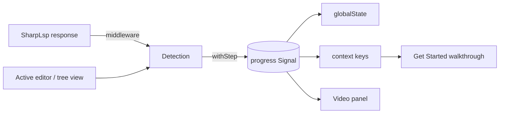

# VS Code Interactive Tutorial Spec `[TUTORIAL]`

**Status:** active · **Owner:** VS Code extension (`src/editors/vscode/src/tutorial/`) · **Issue:** #412 · **Plan:** [VSCODE-TUTORIAL-PLAN.md](../plans/VSCODE-TUTORIAL-PLAN.md)

---

## Goal `[TUTORIAL-GOAL]`

When SharpLsp first opens, it teaches itself in the user's own editor. A video panel plays a short film for the current step while the user carries out the step's action in the live editor. Once the action works, the step ticks itself off and the next film starts.

A step ticks only when SharpLsp itself answers the action. A hover that returns no Quick Info, or a definition request that finds nothing, does not count. The user never clicks a "Mark done" button: the evidence is the real response.

F# is taught first ([TUTORIAL-STEPS]). The tutorial works in desktop VS Code and in browser VS Code served from the user's machine (`code serve-web`), because both run the extension host, and so SharpLsp, locally ([TUTORIAL-BROWSER]).

## Model `[TUTORIAL-MODEL]`

The model is defined in typeDiagram, in [docs/models/vscode-tutorial.td](../models/vscode-tutorial.td). The extension's `src/tutorial/model.generated.ts` is generated from it by `node tools/vsix/tutorial-model.mjs`, and `make _lint-vsix` fails when the generated file is stale (`--check`).

## Steps `[TUTORIAL-STEPS]`

Each language has the same six steps, in this order. The F# walkthrough is contributed first and is the one the first run opens.

| Action | The user | Ticks when | Film |
|--------|----------|------------|------|
| `OpenFile` | opens a source file of the language | an editor of the language becomes active | F#: `fsharp-language`; C#: `getting-started` |
| `Hover` | hovers a symbol | `textDocument/hover` answers with content | `hover` |
| `Completion` | triggers completion | `textDocument/completion` answers with at least one item | `code-completions` |
| `Definition` | goes to a definition | `textDocument/definition` answers with at least one location | `navigation` |
| `References` | finds all references | `textDocument/references` answers with at least one location | `navigation` |
| `SolutionExplorer` | shows the Solution Explorer | the Solution Explorer view becomes visible | `sharplsp-tour` |

The films are the website's published films, served from `https://sharplsp.dev/assets/videos/<film>.webm`. The step table in `src/tutorial/steps.ts` is the only place that names them.

## Detection `[TUTORIAL-DETECT]`

### LSP Responses `[TUTORIAL-DETECT-LSP]`

A `sendRequest` middleware sits outside the request hold ([DIST-FAILURE-UX] rule 6), and observes each response after it arrives. It never changes, delays or drops a response, and an exception inside it never reaches the request.

A response counts toward a step when all of these hold:

1. The request is one of the four methods in [TUTORIAL-STEPS].
2. Its `textDocument.uri` names a document VS Code has open, with language `fsharp` or `csharp`. That language picks the walkthrough.
3. The response is *meaningful*:
   - for hover, a non-null result whose `contents` is a non-empty string, a non-empty array, or a markup or marked string with non-empty `value`;
   - for completion, a non-empty array, or a list whose `items` is non-empty;
   - for definition and references, a single location or a non-empty array of locations.

A request that fails, or is cancelled, never counts.

### Editor Events `[TUTORIAL-DETECT-EDITOR]`

- `OpenFile` ticks when the active text editor's document is a `file` or `untitled` document with language `fsharp` or `csharp`. The first-run check applies to the editor already active at activation, too.
- `SolutionExplorer` ticks for **both** languages when the Solution Explorer view becomes visible, including when it is already visible at activation. The Solution Explorer is shared by both languages.

## Progress `[TUTORIAL-PROGRESS]`

Progress is a `Signal<TutorialProgress>` in `src/tutorial/progress.ts`, the single source of truth ([VSCODE-REACTIVITY-STATE]). Recording a step that is already done is a no-op that notifies nobody.

- **Persistence:** every change is written to `globalState` under `sharplsp.tutorial.progress`, and read back at activation. A stored value that is not a valid progress (`isTutorialProgress`) is discarded with a warning, and the tutorial starts empty.
- **Context keys:** every change sets `sharplsp.tutorial.<Language>.<Action>` (for example `sharplsp.tutorial.FSharp.Hover`) to whether the step is done. The walkthrough reads these keys ([TUTORIAL-WALKTHROUGH]).
- **Reset:** the command `sharplsp.tutorial.reset` clears progress, so every step, every context key and the panel return to their starting state.

## Walkthrough `[TUTORIAL-WALKTHROUGH]`

The manifest contributes two walkthroughs to VS Code's Get Started page: `sharplsp.tutorial.fsharp` ("Learn SharpLsp with F#") first, then `sharplsp.tutorial.csharp`. Each lists the six steps in [TUTORIAL-STEPS] order.

- Each step's `completionEvents` is exactly `onContext:sharplsp.tutorial.<Language>.<Action>`, so the tick comes from [TUTORIAL-PROGRESS], never from a click.
- The `OpenFile` step's description links `sharplsp.tutorial.openFile` with the language, which opens the workspace's first source file of that language.
- Every step's description links `sharplsp.tutorial.open`, which shows the video panel.
- Step titles and descriptions are localized in `package.nls.json`, `package.nls.ja.json` and `package.nls.zh-cn.json`.

## Video Panel `[TUTORIAL-PANEL]`

`sharplsp.tutorial.open` shows a single webview panel, "SharpLsp Tutorial", beside the active editor. Running it again reveals the same panel. It takes an optional language, which defaults to F#.

- **Contents:** a language switch (F#, then C#), the selected language's six steps, each marked done or not, and the current step's film. The current step is the first step not yet done. When all six are done, the panel says so and shows no film.
- **Reactivity:** the panel is a projection of the progress signal and the selected language. A change posts the new view to the webview, which updates in place. The film element is replaced only when the current step's film changes, so a tick that leaves the same film current does not restart it.
- **Film:** `<video>` with `controls`, `autoplay`, `muted`, `loop` and `playsinline`. Its poster is `<film>-poster.webp`, and its captions are `<film>.en.vtt`. The content security policy allows media, images and captions from `https://sharplsp.dev` only, and scripts by nonce only. If the film cannot load (for example offline), the panel shows the step's instructions in its place.
- **Format:** WebM only. Desktop VS Code's webview cannot play H.264, so the panel never names an `.mp4`.

## First Run `[TUTORIAL-FIRST-RUN]`

On the first activation after install, SharpLsp opens the F# walkthrough and the video panel beside it, then records `sharplsp.tutorial.shown` in `globalState` so it never opens them on its own again.

- The setting `sharplsp.tutorial.showOnStartup` (default `true`) turns this off.
- It never runs when the extension host runs in test mode (`ExtensionMode.Test`). Suites open the tutorial through its commands.
- The tutorial is available at any time from the command palette ("SharpLsp: Open Tutorial") and from the Get Started page.

## Browser `[TUTORIAL-BROWSER]`

`code serve-web` serves VS Code to a browser and runs the extension host on the user's machine, so SharpLsp, its sidecars and the tutorial work unchanged. vscode.dev and github.dev cannot run SharpLsp: they have no local extension host.

## Testing `[TUTORIAL-TESTING]`

`src/test/suite/tutorial.test.ts` drives the real extension against the real fixture solution:

- The pure rules: meaningful responses, step lookup, the current step, and progress validation.
- The manifest: the two walkthroughs, F# first, with the six steps in order, each completing on exactly its own context key.
- The live editor: opening an F# file, hovering, completing, going to definition, and finding references each tick their own F# step (and no C# step). The panel's view, the persisted progress and the reset follow.
