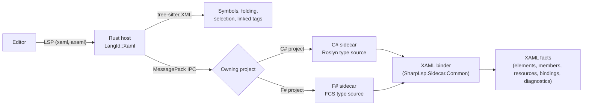

# [XAML-SPEC] XAML: .NET MAUI, WPF, Avalonia, WinUI and Uno

**Parent:** [SHARPLSP-SPEC.md](SHARPLSP-SPEC.md) · **Plan:** [XAML-PLAN.md](../plans/XAML-PLAN.md)

## [XAML-OVERVIEW] Overview

SharpLsp edits XAML with the same compiler-backed intelligence it gives C# and F#, in every editor and on every OS. That covers .NET MAUI `.xaml`, WPF `.xaml`, Avalonia `.axaml`, and WinUI 3 and Uno Platform `.xaml`.

- **Every dialect, one engine.** One XAML binder answers every dialect. A dialect is data: its XML namespaces, its property system and its markup extensions ([XAML-DIALECTS]).
- **Types come from the compiler.** Every element, property, event, resource and binding path resolves to a real Roslyn or FCS symbol. SharpLsp never ships a hand-written list of controls.
- **F# is first-class.** XAML whose view models, converters and code-behind are F# gets the same answers as C# ([XAML-FSHARP]).
- **Nothing proprietary.** SharpLsp reimplements XAML binding from the published XAML language specification, the frameworks' public APIs and their open-source build tasks. It never loads Visual Studio, Rider or C# Dev Kit components.

## [XAML-SCOPE] Scope

### [XAML-SCOPE-VERSIONS] Versions

Only the latest releases are supported. Earlier versions may work, but they are not tested.

| Dialect | Supported | Project marker |
|---|---|---|
| .NET MAUI | .NET MAUI 10 on the .NET 10 SDK | `<UseMaui>true</UseMaui>` |
| WPF | net10.0-windows | `<UseWPF>true</UseWPF>` |
| Avalonia | Avalonia 12 | a reference to the `Avalonia` package |
| WinUI 3 | Windows App SDK 1.8 | `<UseWinUI>true</UseWinUI>` |
| Uno Platform | Uno.Sdk 6 | `Sdk="Uno.Sdk"` |

The out-of-scope technologies are Xamarin.Forms, UWP, Silverlight, `XamlReader` strings built at runtime, and Workflow Foundation `.xaml`.

### [XAML-SCOPE-FILES] File Kinds

| File | Kind | Role |
|---|---|---|
| `*.xaml`, `*.axaml` | Page | A XAML file with an `x:Class`: a page, window, view or control |
| `App.xaml`, `App.axaml` | Application | Application resources and styles, in scope for every page |
| `*.xaml`, `*.axaml` with no `x:Class` | Dictionary | A resource dictionary or style file, merged by `Source=` |
| `*.xaml.cs`, `*.axaml.cs`, `*.xaml.fs`, `*.axaml.fs` | Code-behind | The partial class the page's `x:Class` names |

The dialect of a XAML file is its project's dialect. A file whose project has no XAML dialect is a Workflow or unknown file: SharpLsp leaves it to the editor's XML support.

### [XAML-SCOPE-ANYWHERE] Every OS

XAML intelligence works wherever the project loads. That reaches places Visual Studio does not.

- **WPF and WinUI on macOS and Linux:** the sidecar loads them with `EnableWindowsTargeting=true` and reads the Windows Desktop reference assemblies. It can't run the app, but every editing feature works.
- **.NET MAUI on Linux:** an Android-targeting MAUI project loads with the MAUI Android workload.

### [XAML-SCOPE-FORMATTING] Formatting

SharpLsp formats no language ([SHARPLSP-FEATURES-FORMATTING]), so XAML files get no formatting either. The editor's own XML formatter, or a XAML styler, stays in charge.

## [XAML-RESEARCH] How the XAML Toolchains Work

These findings are the facts this design rests on. Items marked **open** must be confirmed by a research spike before the dependent phase starts ([XAML-PLAN-RESEARCH]).

1. **Every dialect compiles XAML at build time, inside an MSBuild task.**
   - **.NET MAUI:** XamlC rewrites IL after compilation. Since .NET 10, the project can opt into a Roslyn source generator instead, which turns each XAML file into C# at compile time.
   - **WPF:** `PresentationBuildTasks` runs markup compilation. Pass 1 writes `obj/**/*.g.cs` with `InitializeComponent` and one field per `x:Name`.
   - **Avalonia:** XamlIl rewrites IL after compilation, and the `Avalonia.Generators` source generator writes the `x:Name` fields.
   - **WinUI 3 and Uno:** a XAML compiler writes `*.g.cs` and `*.g.i.cs`. Uno's runs as a source generator.

   None of these runs per keystroke. So SharpLsp binds XAML itself, against the compilation, and uses the build's outputs only where a source generator exposes them.
2. **XAML names resolve through XML namespaces.**
   - **Explicit CLR namespaces:** `clr-namespace:Ns;assembly=Asm`, or `using:Ns` in WinUI, Uno and Avalonia.
   - **URI namespaces:** a URI such as `http://schemas.microsoft.com/dotnet/2021/maui` maps to CLR namespaces through `[XmlnsDefinition]` attributes on the referenced assemblies. Every one of these is readable from Roslyn assembly metadata.
   - **.NET MAUI 10:** adds a global XML namespace, declared by `[XmlnsDefinition]` in the project's own source, and implicit default namespaces enabled by a project property. Both are preview features in .NET 10.
3. **The property systems differ only by naming convention.**
   - **MAUI:** `BindableProperty` with a static `XProperty` field.
   - **WPF and WinUI:** `DependencyProperty` with a static `XProperty` field.
   - **Avalonia:** `StyledProperty`, `DirectProperty` and `AttachedProperty` with a static `XProperty` field.

   An attached property is a static field plus `GetX` and `SetX` methods on its owner. All of it is visible in symbols.
4. **Compiled bindings name their source type.**
   - **`x:DataType`:** MAUI, Avalonia and WPF (the last through a toolkit) type a binding's source with it, and the path is checked against that type.
   - **`x:Bind`:** WinUI and Uno bind against the page's own class, and the path can call methods.
   - **No type:** a binding with no source type has no type to check, so its path is untyped.
5. **open: MAUI source-generated XAML.** Does the generated C# carry `#line` directives back to the XAML file? If it does, a XAML hot-reload delta is a C# Edit and Continue delta, as for Razor ([XAML-HOT-RELOAD]).
6. **open: `dotnet watch` and XAML.** Which dialects does `dotnet watch` reload XAML for, and through which agent? Visual Studio's own XAML Hot Reload is proprietary, so SharpLsp cannot use it.
7. **The Avalonia previewer protocol is open source.** `Avalonia.Remote.Protocol` (MIT) is the transport the previewer host uses: it sends XAML updates and receives rendered frames. SharpLsp can drive it from a webview ([XAML-PREVIEW-AVALONIA]).

## [XAML-ARCHITECTURE] Architecture



### [XAML-ARCHITECTURE-ROUTING] Host Routing

- **Ownership:** `.xaml` and `.axaml` URIs are `LangId::Xaml`. The sidecar of the project that lists the file owns it: the C# sidecar for a C# project and the F# sidecar for an F# project ([SHARPLSP-ARCHITECTURE-PROJECTS-OWNERSHIP]). The owner receives the file's `didOpen` and `didChange` text and its diagnostics pulls.
- **Syntax requests:** the host answers `documentSymbol`, `foldingRange`, `selectionRange` and `linkedEditingRange` from tree-sitter XML, within the syntax-only latency target ([SHARPLSP-ARCHITECTURE-ROUTING]).
- **Completion triggers:** the server adds `<`, `.`, `:`, `{`, `"` and space as XAML completion triggers. A C# or F# document triggered by one of the characters it does not use answers `null` at once, without reaching a sidecar.
- **Diagnostic source:** XAML diagnostics publish under the source `sharplsp-xaml`.

### [XAML-ARCHITECTURE-PARSER] Parsing

- **Sidecars:** the binder parses with `GuiLabs.Language.Xml`, a full-fidelity XML parser whose tree keeps every character and span. A file with unclosed tags still yields a tree, so features keep working while the user types. Never regex, never `System.Xml` on live text.
- **Host:** tree-sitter XML, for syntax-only requests.
- **Markup extensions:** the binder parses `{…}` attribute values with its own recursive-descent parser over the attribute's span, into a markup-extension tree.

### [XAML-ARCHITECTURE-TYPES] Type Sources

The binder is language-neutral. It asks a type source for types, members and attributes, and never sees Roslyn or FCS directly.

- **Roslyn type source (C# sidecar):** the project compilation's symbols, including referenced assemblies and F# projects read as built DLLs ([DEFINITION-CROSSLANG]).
- **FCS type source (F# sidecar):** the F# project's checked entities, plus its referenced assemblies.
- **Identity:** a symbol's identity is its assembly and documentation-comment ID, so references and rename cross between XAML, C# and F# ([DEFINITION-CROSSLANG-IDENTITY]).

### [XAML-ARCHITECTURE-FACTS] XAML Facts

```typediagram
typeDiagram

# Everything the binder knows about one XAML file.
type XamlFacts {
  dialect: XamlDialect
  kind: XamlFileKind
  # The `x:Class` type, when the file has one.
  class: Option<SymbolId>
  namespaces: List<XmlnsMapping>
  elements: List<XamlElement>
  members: List<XamlMember>
  resources: List<XamlResource>
  bindings: List<XamlBinding>
  diagnostics: List<XamlDiagnostic>
}

union XamlDialect { Maui, Wpf, Avalonia, WinUI, Uno }

union XamlFileKind { Page, Application, Dictionary }

# One `xmlns:prefix="…"` and the CLR namespaces it resolves to.
type XmlnsMapping {
  prefix: String
  uri: String
  clr_namespaces: List<String>
  declaration: TextSpan
}

# An element, bound to the CLR type it creates.
type XamlElement {
  name: TextSpan
  type: Option<SymbolId>
  # The element's `x:Name` or `Name`, when it has one.
  x_name: Option<TextSpan>
}

# An attribute or property element, bound to the member it sets.
type XamlMember {
  name: TextSpan
  kind: XamlMemberKind
  member: Option<SymbolId>
  value: Option<XamlValue>
}

union XamlMemberKind { Property, AttachedProperty, Event, Directive }

union XamlValue {
  Literal { span: TextSpan }
  Extension { name: TextSpan, extension: Option<SymbolId>, arguments: List<XamlMember> }
}

# A keyed resource: its declaration and every lookup of its key.
type XamlResource {
  key: String
  declaration: TextSpan
  type: Option<SymbolId>
}

# A binding path and the source type it is checked against.
type XamlBinding {
  path: TextSpan
  source_type: Option<SymbolId>
  # One resolved member per path segment; None past the first unresolved one.
  segments: List<Option<SymbolId>>
}

type XamlDiagnostic {
  code: String
  span: TextSpan
  message: String
}
```

### [XAML-ARCHITECTURE-RESOURCES] Resource Scope

A `StaticResource` or `DynamicResource` key resolves the way the framework resolves it at runtime:

1. the element's own resources, then each ancestor's;
2. the file's root resources, with its merged dictionaries;
3. the application's resources, with its merged dictionaries;
4. the dialect's theme resources, read from the framework's assemblies.

A merged dictionary's `Source=` resolves to a workspace file. A key that exists in a later scope, but only for a different theme, resolves to every candidate.

## [XAML-DIALECTS] Dialects

| Concern | MAUI | WPF | Avalonia | WinUI 3 | Uno |
|---|---|---|---|---|---|
| Extension | `.xaml` | `.xaml` | `.axaml` (`.xaml` too) | `.xaml` | `.xaml` |
| Property field | `BindableProperty` | `DependencyProperty` | `StyledProperty`, `DirectProperty`, `AttachedProperty` | `DependencyProperty` | `DependencyProperty` |
| CLR namespace syntax | `clr-namespace:` | `clr-namespace:` | `clr-namespace:`, `using:` | `using:` | `using:` |
| Typed bindings | `x:DataType` | `d:DataContext` (design-time) | `x:DataType`, `x:CompileBindings` | `x:Bind` | `x:Bind` |
| Styles | `Style TargetType` | `Style TargetType` | CSS-like `Selector` | `Style TargetType` | `Style TargetType` |
| Platform values | `OnPlatform`, `OnIdiom` | — | `OnPlatform`, `OnFormFactor` | — | platform XML namespaces |

- **Avalonia selectors:** a `Selector` is parsed into its type, class, pseudo-class and property parts, and each type part binds to a symbol.
- **`x:Bind`:** a path can call methods and pass arguments, so its segments bind as C# member access on the page class, and method calls get signature help.
- **Design-time namespaces:** `d:` and `mc:Ignorable` attributes bind like real ones, but never produce runtime diagnostics.

## [XAML-FEATURES] Features

### [XAML-FEATURES-DIAGNOSTICS] Diagnostics

The binder reports only what it can prove. A name that fails to resolve because the type source is incomplete (restore not run, workspace still loading) is never reported ([DIAG-TRUTH]).

| Code | Reported when |
|---|---|
| `XAML0001` | An element's prefix is not declared |
| `XAML0002` | An element's type is not found in its fully resolved namespaces |
| `XAML0003` | An attribute is not a property, attached property or event of the element's type |
| `XAML0004` | A literal value cannot convert to the property's type (enum member, `Color`, `Thickness`, numbers) |
| `XAML0005` | A `StaticResource` key is in no scope ([XAML-ARCHITECTURE-RESOURCES]) |
| `XAML0006` | A typed binding's path segment is not a member of its source type |
| `XAML0007` | An event handler named in XAML is not a method of the `x:Class` with a compatible signature |
| `XAML0008` | `x:Class` names no partial class in the project |
| `XAML0009` | Two elements in one name scope share an `x:Name` |
| `XAML0010` | A merged dictionary's `Source=` names no file |

- **Build errors:** after a build, the XAML compiler's own errors for open files are shown too, mapped to their XAML spans, with the compiler's code (`XC`, `MC`, `AVLN`, `WMC`).
- **Untyped bindings:** a binding with no source type is never an error. An information diagnostic offers to add `x:DataType` ([XAML-CODE-ACTIONS-DATATYPE]).

### [XAML-FEATURES-COMPLETION] Completion

- **After `<`:** the types that can go there. Inside a content property, that is the types assignable to it. At the root, it is the dialect's root types. Each item is shown with its XML prefix. Choosing a type whose namespace has no prefix yet adds the `xmlns` declaration as an additional edit, and its detail says which prefix it adds.
- **In a start tag:** the element's settable properties, attached properties of types in scope, events, and `x:` directives, excluding attributes already set.
- **In a value:**
  - enum members, `true` and `false`, and named colors;
  - resource keys in scope, filtered by the property's type, after `StaticResource` or `DynamicResource`;
  - the dialect's markup extensions after `{`.
- **In a binding path:** members of the source type, segment by segment. An untyped binding completes nothing, never a guess.
- **Event values:** the compatible methods of the `x:Class`, plus a *generate handler* item ([XAML-CODE-ACTIONS-HANDLER]).
- **Closing tags:** typing `</` completes the open element's name.

### [XAML-FEATURES-HOVER] Hover

Hover shows the bound symbol's signature and documentation, in the same format as C# and F# hover ([HOVER-SPEC]). That applies to:

- elements, properties, attached properties and events;
- markup extensions;
- binding path segments, with the source type named;
- resource keys, with their declared type and declaring file;
- `xmlns` prefixes, listing the CLR namespaces they map.

### [XAML-FEATURES-DEFINITION] Definition

- **Types and members:** definition lands on their C# or F# declaration. A framework type lands on decompiled or source-linked source, as in C# ([DEFINITION-NAVIGATION]).
- **Resource keys:** definition lands on the `x:Key` declaration, which may be in another XAML file.
- **Event handlers and `x:Class`:** definition lands in the code-behind.
- **`x:Name`:** definition from code-behind (`this.SubmitButton`) lands on the XAML element, not on generated code.
- **`Source=`:** definition opens the merged dictionary.

### [XAML-FEATURES-REFERENCES] References and Highlights

- **References from XAML or code:** find references on a C# or F# property, type or method includes its XAML uses: elements, attributes, binding path segments, `x:Bind` paths and event handlers.
- **Resource keys:** find references on a resource key lists every lookup of it across the project's XAML files.
- **`x:Name`:** references on an element's `x:Name` list its code-behind uses.
- **Document highlights:** these mark the same symbol within the file.

### [XAML-FEATURES-RENAME] Rename

- **Code symbols:** renaming a C# or F# symbol edits its XAML uses in the same workspace edit ([RENAME-CROSSLANGUAGE]). That includes a view-model property bound by path, an event handler, and a type used as an element.
- **XAML names:** renaming an `x:Name` renames its code-behind uses. Renaming an `x:Key` renames every lookup.
- **Refusals:** a rename whose XAML use cannot be edited exactly (a path built at runtime, a string `Binding` in code) is refused with its reason ([REFACTOR-NEVER-SILENT]).

### [XAML-FEATURES-SEMANTIC-TOKENS] Semantic Tokens

Elements are colored as types, attributes as properties or events, markup extensions as types, binding paths as properties, and resource keys as variables. The tokens use the same legend as C# ([SHARPLSP-FEATURES-HIGHLIGHTING]).

### [XAML-FEATURES-STRUCTURE] Symbols, Folding and Linked Editing

- **Document symbols:** the element tree. An element with an `x:Name` is shown by name, and resources by key.
- **Folding:** elements, comments and property elements fold.
- **Linked editing:** editing a start tag's name edits its end tag.

### [XAML-FEATURES-INLAY-HINTS] Inlay Hints

An untyped binding gets no hint. A typed binding's path gets a hint with the resolved type of its last segment.

### [XAML-FEATURES-COLOR] Colors

Color literals and named colors answer `textDocument/documentColor`, so the editor shows a swatch and picker. `colorPresentation` writes the dialect's literal form.

## [XAML-CODE-ACTIONS] Code Actions

Every action states exactly what it changes in its title, and none fails silently ([REFACTOR-NEVER-SILENT]).

### [XAML-CODE-ACTIONS-XMLNS] Add XML Namespace

On `XAML0001` or `XAML0002`, the action lists each type with that name in the project's references. Each title names the prefix and namespace it adds, for example *Add xmlns:vm="clr-namespace:Shop.ViewModels" for OrderViewModel*. A type that is only in an unreferenced project in the solution is offered with the project reference it adds ([REFACTOR-IMPORT-REFERENCE]).

### [XAML-CODE-ACTIONS-HANDLER] Generate Event Handler

On `XAML0007`, or from the completion item, the action adds a method with the event's signature to the code-behind, in C# or F#. The title names the method, the class and the file.

### [XAML-CODE-ACTIONS-DATATYPE] Add `x:DataType`

On an untyped binding, the action offers each type in scope that the binding's path resolves on. Its title names the type. It adds `x:DataType` at the nearest element that sets the binding's source.

### [XAML-CODE-ACTIONS-RESOURCE] Extract to Resource

On a literal value or a style's setters, the action moves the value into a keyed resource. The user picks the page, the application or a named dictionary, and each lookup becomes `{StaticResource Key}`.

### [XAML-CODE-ACTIONS-NEW-FILE] New XAML File

The Solution Explorer's *Add* menu offers a page, window, user control and resource dictionary for the project's dialect. It writes the XAML file and its C# or F# code-behind, and adds `Compile` and `Page` items only when the project does not glob them ([SE-ADD-FILE-REQUEST]).

## [XAML-SOLUTION-EXPLORER] Solution Explorer

- **Nesting:** a XAML file's code-behind nests under it.
- **VS Code Explorer:** the extension's `contributes.configurationDefaults` gives `explorer.fileNesting.patterns` the entries `*.xaml` → `${capture}.xaml.cs, ${capture}.xaml.fs` and `*.axaml` → `${capture}.axaml.cs, ${capture}.axaml.fs`. They apply when the user turns on file nesting, and the user's own patterns win.

## [XAML-HOT-RELOAD] Hot Reload

A saved XAML file in the debugged project hot reloads without a restart. The design depends on the dialect, and each row ships only after its research item closes ([XAML-RESEARCH]).

| Dialect | Mechanism | Status |
|---|---|---|
| MAUI with the source generator | The XAML file is an additional document. Its generated C# is reemitted, and Edit and Continue applies the delta, as for Razor ([RAZOR-HOT-RELOAD], [DEBUG-FEATURES-HOT-RELOAD]) | Depends on research item 5 |
| MAUI with XamlC, WPF, Avalonia, WinUI, Uno | A runtime agent in the debuggee reloads the changed element tree, through public framework APIs only | Depends on research item 6 |

- **Save before apply:** the binder's errors block a reload. The user sees the diagnostic instead of a silently stale screen.
- **Failure:** a reload that fails says why, and how to restart. It never fails silently.

## [XAML-PREVIEW] Live Preview

### [XAML-PREVIEW-AVALONIA] Avalonia

A *Preview* command opens a webview beside the XAML file. It starts the framework's previewer host for the built project and sends it the live buffer over `Avalonia.Remote.Protocol` on every change. It shows the rendered frames, and forwards pointer input. The preview works on Windows, macOS and Linux.

### [XAML-PREVIEW-RUNNING-APP] Running App (MAUI, WPF, WinUI, Uno)

These dialects have no open previewer host. Their preview is the running app on the desktop target (Windows, Mac Catalyst or Skia desktop), kept current by hot reload ([XAML-HOT-RELOAD]). A visual tree view lists the running app's elements, and selecting one reveals its XAML element.

## [XAML-FSHARP] F# and XAML

F# goes first: every feature above ships for F# projects in the same release as for C#.

- **XAML in an F# project:** an Avalonia or WPF project whose code-behind is `.xaml.fs` or `.axaml.fs` is owned by the F# sidecar. Its types come from FCS, so view models, records, unions and modules in the project bind live, before a build.
- **F# view models in a C# app:** a C# XAML project that references an F# library reads it as its built DLL. Definition, references and rename cross into the F# source through symbol identity ([DEFINITION-CROSSLANG-IDENTITY], [RENAME-CROSSLANGUAGE]).
- **F# members in XAML:**
  - A record field or property is a bindable path segment.
  - A union case's `IsCase` test is a bindable boolean.
  - A module function is not a XAML member, so it never completes.
- **Generated handlers:** these are F# members with the event's signature, written with the project's indentation.

## [XAML-EDITORS] Editors

- **VS Code:**
  - The client syncs `xaml` and `axaml` documents, and contributes the `axaml` language with XML grammar if no other extension has.
  - It activates on `onLanguage:xaml` and `onLanguage:axaml`.
  - The preview webview is VS Code only.
- **Zed:** the server attaches to the `XAML` language that community extensions define.
- **Other LSP clients:** the language ids are `xaml` and `axaml`, and the file types are `.xaml` and `.axaml`.

## [XAML-ERRORS] Degradation

- **Unknown dialect:** a XAML file in a project with no dialect answers syntax requests only.
- **Unresolved namespace:** while a referenced assembly is missing, elements in its namespaces answer empty and produce no diagnostic ([DIAG-TRUTH]).
- **Nothing at the position:** the answer is `null` or an empty list, never an error.
- **No content logged:** XAML text, attribute values and resource values are never logged. Logs carry only paths, spans, lengths and counts.

## [XAML-TESTING] Tests

- **Fixture:** `src/sharplsp/tests/fixtures/xaml/XamlFixtures.slnx` is a real solution of buildable projects:

  | Project | What it is |
  |---|---|
  | `MauiApp` | MAUI 10, one page with XamlC and one with the source generator |
  | `WpfApp` | WPF net10.0-windows, built with `EnableWindowsTargeting` |
  | `AvaloniaApp` | Avalonia 12, C# code-behind, compiled bindings and selectors |
  | `AvaloniaFs` | Avalonia 12 with F# code-behind and F# view models |
  | `WinUIApp` | WinUI 3, `x:Bind` |
  | `ViewModels` | An F# library of view models used by `MauiApp` and `WpfApp` |

- **Binder tests:** each dialect in [XAML-DIALECTS], each diagnostic code, and every resource scope rule.
- **Rust end-to-end tests:** the full stack over the fixture. A test opens, edits, completes, hovers, goes to definition, finds references and renames in the same session, and asserts on each step.
- **VS Code end-to-end tests:** a `xaml` chunk drives the real extension through the same features, plus file nesting, *New XAML File* and the Avalonia preview.
