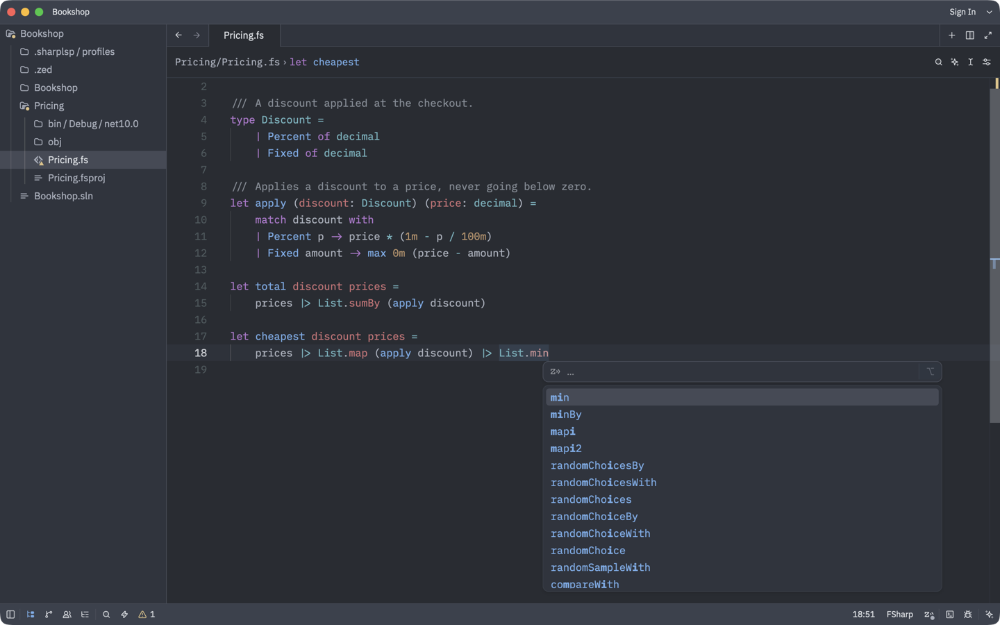
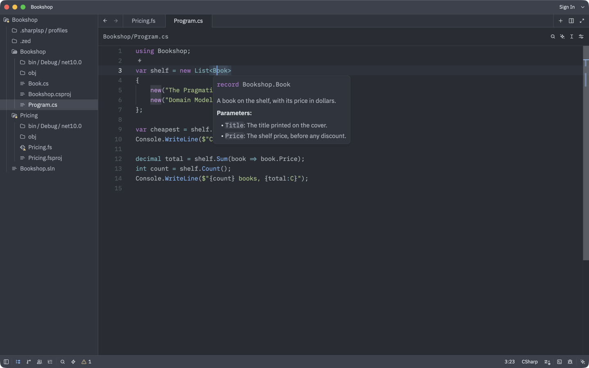

# SharpLsp in Zed

C# and F# code intelligence for [Zed](https://zed.dev).



## Install

1. Install the [.NET 10 SDK](https://dotnet.microsoft.com/download/dotnet/10.0) and [Rust](https://www.rust-lang.org/tools/install).
2. In Zed, open the Extensions page and install **C#** and **F#**.
3. Clone SharpLsp:

   ```sh
   git clone https://github.com/Nimblesite/SharpLsp.git
   ```

4. On the Extensions page, click **Install Dev Extension** and select the `src/editors/zed` folder in the clone.
5. Open your .NET project folder, and trust it when Zed asks.
6. If the folder contains more than one `.sln` or `.slnx` file, anywhere inside it, follow Choose the solution below. Otherwise SharpLsp loads no C# projects.

SharpLsp downloads its server the first time you open a C# or F# file.



## Choose the solution

For C#, SharpLsp searches the whole folder you opened, including subfolders, for `.sln` and `.slnx` files. If it finds exactly one, it loads it. If it finds more than one, it loads **none**, because it can't tell which one you want. You still get syntax highlighting, which comes from Zed's C# extension, but no hover, completions, go to definition or diagnostics in C# files. F# projects load either way. SharpLsp shows an error, and its language server log says:

```text
Found 11 solutions under '/path/to/folder' (...), so which one to load is ambiguous.
```

To fix it, choose the solution in Zed's settings or in a `sharplsp.toml` file. If you do both, Zed's setting wins.

### In Zed's settings

1. Press <kbd>Cmd+Shift+P</kbd> (<kbd>Ctrl+Shift+P</kbd> on Linux and Windows) and run `zed: open project settings`.
2. Add the path of the solution you want, relative to the folder you opened:

   ```json
   {
     "lsp": {
       "sharplsp": {
         "settings": {
           "csharp": { "solution_path": "src/MyApp.sln" }
         }
       }
     }
   }
   ```

3. Save the file. SharpLsp loads the solution without a restart.

### In `sharplsp.toml`

1. Create a file named `sharplsp.toml` in the folder you opened in Zed.
2. Put the path of the solution you want in it, relative to that folder:

   ```toml
   [csharp]
   solution_path = "src/MyApp.sln"
   ```

3. Press <kbd>Cmd+Shift+P</kbd> (<kbd>Ctrl+Shift+P</kbd> on Linux and Windows) and run `editor: restart language server`.

Hover over any type to check that it worked.

## Use SharpLsp instead of the other C# and F# servers

Add this to your Zed settings (`zed: open settings file`):

```json
{
  "languages": {
    "CSharp": { "language_servers": ["sharplsp", "!omnisharp", "!roslyn", "!csharp-ls", "..."] },
    "FSharp": { "language_servers": ["sharplsp", "!fsautocomplete", "..."] }
  }
}
```

## Troubleshooting

| Problem | Fix |
|---|---|
| C# files have syntax highlighting, but no hover, completions or diagnostics | The folder has more than one solution. See Choose the solution. |
| SharpLsp never starts | Install Zed's C# and F# extensions, and trust the folder. |
| Completions or diagnostics appear twice | Another C# or F# server is still running. See Use SharpLsp instead of the other C# and F# servers. |

To see what went wrong, open the command palette (<kbd>Cmd+Shift+P</kbd> or <kbd>Ctrl+Shift+P</kbd>) and run:

- `zed: open log` for problems installing or downloading SharpLsp;
- `dev: open language server logs`, then choose **SharpLsp**, for problems once it's running.
