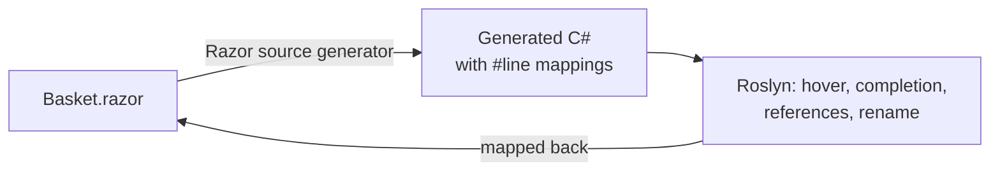

# Blazor and Razor

SharpLsp edits Razor files in VS Code with the same Roslyn engine it uses for C#. That covers [Blazor](https://learn.microsoft.com/en-us/aspnet/core/blazor/?view=aspnetcore-10.0) components (`.razor`), and ASP.NET Core [Razor Pages](https://learn.microsoft.com/en-us/aspnet/core/razor-pages/?view=aspnetcore-10.0) and [MVC views](https://learn.microsoft.com/en-us/aspnet/core/mvc/views/overview?view=aspnetcore-10.0) (`.cshtml`).

The C# inside the markup gets hover, completion, diagnostics, navigation and rename: `@` expressions, `@code` blocks, event handlers and `@bind` values. The HTML around it gets your editor's HTML support.



## What Works in a Razor File

| Feature | What you get |
|---|---|
| Hover | Roslyn's hover for the C# under the cursor, with its signature and XML documentation, ranged on the Razor text |
| Completion | Roslyn completion inside `@` expressions and `@code` blocks. Every edit lands in the Razor file, and a `using` that completion adds becomes an `@using` line |
| Signature help | Parameter help inside a call |
| Diagnostics | C# errors and warnings on the Razor line that caused them, and Razor files in the solution-wide scan |
| Go to definition | From markup to the declaration, such as a method in the `@code` block. From C#, a component's definition is its `.razor` file: `MapRazorComponents<App>()` goes to `App.razor` |
| References and highlights | Every use in your Razor files. The compiler's hidden scaffolding is left out |
| Rename | A field or member of the `@code` block, renamed at every use in the markup. Rename refuses on plain markup |
| Semantic highlighting | Roslyn's classification for the C# in the file. The editor's Razor grammar colors the markup |
| Folding and outline | Multi-line elements and `@code` blocks fold. The outline lists directives and elements, with the members of each `@code` block nested under it |
| Linked editing | In a component, a start tag and its end tag rename together |

Results never point into generated code. A position in a file's generated C# always maps back to its Razor file.

Razor files never report a `using` as unnecessary. Markup resolves component tags through usings that the generated C# never needs, and the usings in [`_Imports.razor`](https://learn.microsoft.com/en-us/aspnet/core/blazor/tutorials/movie-database-app/part-1?view=aspnetcore-10.0#components_importsrazor-file) and `_ViewImports.cshtml` serve the files beside and below them. C# files, including a component's `.razor.cs` code-behind, still report them.

## HTML in the Markup

- **VS Code:** element and attribute completion, and HTML hovers, come from VS Code's built-in HTML language service. SharpLsp forwards the request with an HTML view of the file, the pattern VS Code's [Embedded Programming Languages](https://code.visualstudio.com/api/language-extensions/embedded-languages) guide describes. Its own items come first.
- **Zed:** Zed has no built-in Razor language. Install a Razor extension from Zed's extension registry, and SharpLsp attaches to the `Razor` language it defines.
- **Other LSP clients:** the language id is `razor`, for `.razor` and `.cshtml` files. Pair SharpLsp with an HTML language server for the markup.

## How It Works

SharpLsp never reimplements Razor. Since .NET 6, the [Razor compiler runs as a Roslyn source generator](https://learn.microsoft.com/en-us/aspnet/core/release-notes/aspnetcore-6.0?view=aspnetcore-10.0#razor-compiler-updated-to-use-source-generators), and the C# sidecar's design-time build runs it exactly as `dotnet build` does.

The generator turns each Razor file into C#. It copies every C# fragment into the generated file verbatim, and wraps it in an [enhanced `#line` directive](https://github.com/dotnet/csharplang/blob/main/proposals/csharp-10.0/enhanced-line-directives.md) that points back at the Razor text.

SharpLsp builds a two-way map from those directives, checking each fragment's text on both sides:

1. A request at a Razor position maps to the generated C#.
2. Roslyn answers there, exactly as it would for a `.cs` file.
3. Each answer maps back to the Razor file.

Positions in the compiler's hidden scaffolding have no Razor text, so they never reach you.



The markup comes from the compiler's public [intermediate representation](https://github.com/dotnet/razor). It drives folding, the outline and linked editing, and it builds the HTML view that VS Code's HTML service reads.

## Supported Projects

| File | What it is |
|---|---|
| `*.razor` | A [Razor component](https://learn.microsoft.com/en-us/aspnet/core/blazor/components/?view=aspnetcore-10.0) |
| `_Imports.razor` | Directives for every component in its folder and below |
| `*.cshtml` | A Razor Page (`@page`), MVC view, partial view or layout |
| `_ViewImports.cshtml` | Directives for every page and view in its folder and below |
| `_ViewStart.cshtml` | Code that runs before each view |

- **Apps:** a Blazor Web App (`dotnet new blazor`) with Blazor Server or Blazor WebAssembly [render modes](https://learn.microsoft.com/en-us/aspnet/core/blazor/components/render-modes?view=aspnetcore-10.0), a standalone Blazor WebAssembly app, a Razor Pages or MVC app, and a [Razor class library](https://learn.microsoft.com/en-us/aspnet/core/razor-pages/ui-class?view=aspnetcore-10.0) of shared components.
- **Project SDKs:** `Microsoft.NET.Sdk.Web`, `Microsoft.NET.Sdk.BlazorWebAssembly` and `Microsoft.NET.Sdk.Razor`.
- **Verified:** ASP.NET Core 10 on the [.NET 10](https://devblogs.microsoft.com/dotnet/announcing-dotnet-10/) SDK, including a fresh `dotnet new blazor` app.
- **net8.0 and net9.0:** these projects compile Razor through the same source generator, so they should work, but they are not verified yet.
- **Not supported:** projects older than .NET 6, which compile Razor without a source generator, and ASP.NET MVC 5, Web Pages and Web Forms on .NET Framework.

## SDK Versions

The Razor generator comes from the SDK that builds your project. When no `global.json` pins one, that is the newest SDK you have installed.

Roslyn only loads a generator built for its own version or an older one. SDK 10.0.303's generator loads in the Roslyn that SharpLsp bundles, but SDK 10.0.401's needs a newer Roslyn. A project that builds with 10.0.401 therefore gets no C# features in its Razor files, though its markup features keep working. [Issue #399](https://github.com/Nimblesite/SharpLsp/issues/399) tracks making every SDK work.

Until that is fixed, [install SDK 10.0.303](https://dotnet.microsoft.com/download/dotnet/10.0) and pin it in a `global.json` beside your solution:

```json
{
  "sdk": {
    "version": "10.0.303",
    "rollForward": "latestPatch"
  }
}
```

## Not Yet Supported

Progress is tracked in [issue #397](https://github.com/Nimblesite/SharpLsp/issues/397).

- **Component markup:** hover, definition, completion, references and semantic colors on component tags, component parameters, `@bind-X`, and directive attributes such as `@onclick`.
- **Razor diagnostics:** the compiler's own `RZ` diagnostics, such as an unknown component.
- **Tag helpers:** hover and completion for [tag helper](https://learn.microsoft.com/en-us/aspnet/core/mvc/views/tag-helpers/intro?view=aspnetcore-10.0) elements and attributes such as `asp-for`.
- **F#:** Razor's code language is C#, because the Razor compiler generates only C#, but a Blazor app can reference F# libraries. Hover, completion and definition on F# types used from Razor, and F# renames that reach Razor usages, are planned.
- **Editing:** formatting, selection ranges, code actions, inlay hints, code lens, and call and type hierarchy from Razor positions.
- **Collocated files:** awareness of [CSS isolation](https://learn.microsoft.com/en-us/aspnet/core/blazor/components/css-isolation?view=aspnetcore-10.0) (`.razor.css`) and collocated `.razor.js` files.
- **Runtime:** Blazor WebAssembly debugging and Hot Reload.

## Failure Behavior

- **No projection:** if a project does not run the Razor generator, its Razor files have no C# features. Their markup features still answer.
- **Engine failure:** if the Razor engine fails to load or to process a file, markup features answer empty and C# features keep working. SharpLsp logs the failure once per project, with the project name and the exception type.
- **Nothing at the position:** a position that is neither C# nor a markup element answers nothing, never an error.
- **Privacy:** SharpLsp never logs Razor or generated text, only paths, spans and lengths.

## Microsoft Documentation

- [ASP.NET Core Blazor](https://learn.microsoft.com/en-us/aspnet/core/blazor/?view=aspnetcore-10.0) and [Blazor project structure](https://learn.microsoft.com/en-us/aspnet/core/blazor/project-structure?view=aspnetcore-10.0)
- [Razor syntax reference for ASP.NET Core](https://learn.microsoft.com/en-us/aspnet/core/mvc/views/razor?view=aspnetcore-10.0)
- [Blazor render modes](https://learn.microsoft.com/en-us/aspnet/core/blazor/components/render-modes?view=aspnetcore-10.0), [data binding](https://learn.microsoft.com/en-us/aspnet/core/blazor/components/data-binding?view=aspnetcore-10.0) and [event handling](https://learn.microsoft.com/en-us/aspnet/core/blazor/components/event-handling?view=aspnetcore-10.0)
- [Generic components](https://learn.microsoft.com/en-us/aspnet/core/blazor/components/generic-type-support?view=aspnetcore-10.0) and [cascading values and parameters](https://learn.microsoft.com/en-us/aspnet/core/blazor/components/cascading-values-and-parameters?view=aspnetcore-10.0)
- [What's new in ASP.NET Core in .NET 10](https://learn.microsoft.com/en-us/aspnet/core/release-notes/aspnetcore-10.0?view=aspnetcore-10.0)
- [The Roslyn APIs and source generators](https://learn.microsoft.com/en-us/dotnet/csharp/roslyn-sdk/#source-generators)
