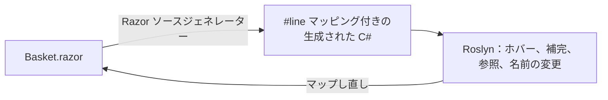

# Blazor と Razor

SharpLsp は、C# に使用するのと同じ Roslyn エンジンで、VS Code の Razor ファイルを編集します。これには [Blazor](https://learn.microsoft.com/ja-jp/aspnet/core/blazor/?view=aspnetcore-10.0) コンポーネント（`.razor`）と、ASP.NET Core の [Razor Pages](https://learn.microsoft.com/ja-jp/aspnet/core/razor-pages/?view=aspnetcore-10.0) および [MVC ビュー](https://learn.microsoft.com/ja-jp/aspnet/core/mvc/views/overview?view=aspnetcore-10.0)（`.cshtml`）が含まれます。

マークアップ内の C# では、ホバー、補完、診断、ナビゲーション、名前の変更が使えます。対象は `@` 式、`@code` ブロック、イベントハンドラー、`@bind` の値です。その周囲の HTML では、エディターの HTML サポートが使えます。



## Razor ファイルで動作する機能

| 機能 | 得られるもの |
|---|---|
| ホバー | カーソル位置の C# に対する Roslyn のホバー。シグネチャーと XML ドキュメントを含み、Razor のテキスト上の範囲に表示されます |
| 補完 | `@` 式と `@code` ブロック内での Roslyn の補完。すべての編集は Razor ファイルに反映され、補完が追加する `using` は `@using` 行になります |
| シグネチャヘルプ | 呼び出し内でのパラメーターのヘルプ |
| 診断 | 原因となった Razor の行に表示される C# のエラーと警告。ソリューション全体のスキャンにも Razor ファイルが含まれます |
| 定義へ移動 | マークアップから宣言へ。たとえば `@code` ブロック内のメソッドへ移動します。C# から見ると、コンポーネントの定義はその `.razor` ファイルです。`MapRazorComponents<App>()` は `App.razor` へ移動します |
| 参照とハイライト | Razor ファイル内のすべての使用箇所。コンパイラーの隠れた足場のコードは除外されます |
| 名前の変更 | `@code` ブロックのフィールドまたはメンバーの名前を変更すると、マークアップ内のすべての使用箇所も変わります。C# を含まないマークアップでは名前の変更を拒否します |
| セマンティックハイライト | ファイル内の C# に対する Roslyn の分類。マークアップはエディターの Razor 文法が色分けします |
| 折りたたみとアウトライン | 複数行の要素と `@code` ブロックが折りたたまれます。アウトラインにはディレクティブと要素が並び、各 `@code` ブロックのメンバーはその下に入れ子になります |
| リンクされた編集 | コンポーネント内で、開始タグと終了タグの名前が一緒に変わります |

結果が生成されたコードを指すことはありません。ファイルの生成された C# 内の位置は、常にその Razor ファイルへマップし直されます。

Razor ファイルは `using` を不要として報告することはありません。マークアップは、生成された C# 自体には不要な using を使ってコンポーネントタグを解決します。また、[`_Imports.razor`](https://learn.microsoft.com/ja-jp/aspnet/core/blazor/tutorials/movie-database-app/part-1?view=aspnetcore-10.0#components_importsrazor-file) と `_ViewImports.cshtml` の using は、その隣と下にあるファイルのためのものです。コンポーネントの `.razor.cs` コードビハインドを含む C# ファイルでは、引き続き報告されます。

## マークアップ内の HTML

- **VS Code:** 要素と属性の補完、および HTML のホバーは、VS Code 内蔵の HTML 言語サービスから提供されます。SharpLsp は、VS Code の [Embedded Programming Languages](https://code.visualstudio.com/api/language-extensions/embedded-languages) ガイドが説明するパターンで、ファイルの HTML ビューとともにリクエストを転送します。SharpLsp 自身の項目が先に表示されます。
- **Zed:** Zed には Razor の組み込み言語がありません。Zed の拡張機能レジストリから Razor 拡張機能をインストールすると、SharpLsp はそれが定義する `Razor` 言語にアタッチします。
- **その他の LSP クライアント:** `.razor` と `.cshtml` ファイルの言語 id は `razor` です。マークアップには、SharpLsp と HTML 言語サーバーを組み合わせてください。

## 仕組み

SharpLsp は Razor を再実装することはありません。.NET 6 以降、[Razor コンパイラーは Roslyn のソースジェネレーターとして動作](https://learn.microsoft.com/ja-jp/aspnet/core/release-notes/aspnetcore-6.0?view=aspnetcore-10.0#razor-compiler-updated-to-use-source-generators)し、C# サイドカーのデザインタイムビルドが `dotnet build` とまったく同じようにそれを実行します。

ジェネレーターは各 Razor ファイルを C# に変換します。すべての C# フラグメントをそのまま生成されたファイルへコピーし、Razor のテキストを指し示す[拡張された `#line` ディレクティブ](https://github.com/dotnet/csharplang/blob/main/proposals/csharp-10.0/enhanced-line-directives.md)でそれを包みます。

SharpLsp はこれらのディレクティブから双方向のマップを構築し、各フラグメントのテキストを両側で照合します。

1. Razor の位置でのリクエストは、生成された C# にマップされます。
2. Roslyn がそこで応答します。`.cs` ファイルの場合とまったく同じです。
3. 各応答は Razor ファイルへマップし直されます。

コンパイラーの隠れた足場のコード内の位置には Razor のテキストがないため、そこに到達することはありません。



マークアップは、コンパイラーの公開された[中間表現](https://github.com/dotnet/razor)から得られます。それが折りたたみ、アウトライン、リンクされた編集を駆動し、VS Code の HTML サービスが読み取る HTML ビューを構築します。

## サポートされるプロジェクト

| ファイル | 内容 |
|---|---|
| `*.razor` | [Razor コンポーネント](https://learn.microsoft.com/ja-jp/aspnet/core/blazor/components/?view=aspnetcore-10.0) |
| `_Imports.razor` | そのフォルダーとその下のすべてのコンポーネント向けのディレクティブ |
| `*.cshtml` | Razor Page（`@page`）、MVC ビュー、部分ビュー、またはレイアウト |
| `_ViewImports.cshtml` | そのフォルダーとその下のすべてのページとビュー向けのディレクティブ |
| `_ViewStart.cshtml` | 各ビューの前に実行されるコード |

- **アプリ:** Blazor Server または Blazor WebAssembly の[レンダーモード](https://learn.microsoft.com/ja-jp/aspnet/core/blazor/components/render-modes?view=aspnetcore-10.0)を使う Blazor Web App（`dotnet new blazor`）、スタンドアロンの Blazor WebAssembly アプリ、Razor Pages または MVC アプリ、および共有コンポーネントの [Razor クラスライブラリ](https://learn.microsoft.com/ja-jp/aspnet/core/razor-pages/ui-class?view=aspnetcore-10.0)。
- **プロジェクト SDK:** `Microsoft.NET.Sdk.Web`、`Microsoft.NET.Sdk.BlazorWebAssembly`、`Microsoft.NET.Sdk.Razor`。
- **検証済み:** [.NET 10](https://devblogs.microsoft.com/dotnet/announcing-dotnet-10/) SDK 上の ASP.NET Core 10。新規の `dotnet new blazor` アプリを含みます。
- **net8.0 と net9.0:** これらのプロジェクトは同じソースジェネレーターを通じて Razor をコンパイルするため、動作するはずですが、まだ検証されていません。
- **非対応:** ソースジェネレーターなしで Razor をコンパイルする .NET 6 より前のプロジェクト、および .NET Framework 上の ASP.NET MVC 5、Web Pages、Web Forms。

## SDK バージョン

Razor ジェネレーターは、プロジェクトをビルドする SDK に由来します。`global.json` で固定されていない場合、それはインストール済みの最新 SDK です。

Roslyn は、自身のバージョンまたはそれより古いバージョン向けにビルドされたジェネレーターしか読み込みません。SDK 10.0.303 のジェネレーターは SharpLsp が同梱する Roslyn に読み込まれますが、SDK 10.0.401 のものはより新しい Roslyn を必要とします。そのため 10.0.401 でビルドするプロジェクトでは、Razor ファイルの C# 機能が利用できませんが、マークアップ機能は引き続き動作します。[Issue #399](https://github.com/Nimblesite/SharpLsp/issues/399) で、すべての SDK を動作させる取り組みを追跡しています。

それが修正されるまでは、[SDK 10.0.303 をインストール](https://dotnet.microsoft.com/download/dotnet/10.0)し、ソリューションの隣の `global.json` で固定してください。

```json
{
  "sdk": {
    "version": "10.0.303",
    "rollForward": "latestPatch"
  }
}
```

## まだサポートされていない機能

進捗は [issue #397](https://github.com/Nimblesite/SharpLsp/issues/397) で追跡しています。

- **コンポーネントのマークアップ:** コンポーネントタグ、コンポーネントパラメーター、`@bind-X`、および `@onclick` などのディレクティブ属性に対するホバー、定義、補完、参照、セマンティックカラー。
- **Razor の診断:** 未知のコンポーネントなど、コンパイラー自身の `RZ` 診断。
- **タグヘルパー:** `asp-for` などの[タグヘルパー](https://learn.microsoft.com/ja-jp/aspnet/core/mvc/views/tag-helpers/intro?view=aspnetcore-10.0)の要素と属性に対するホバーと補完。
- **F#:** Razor のコード言語は C# です。Razor コンパイラーが生成するのは C# のみだからです。ただし Blazor アプリは F# ライブラリを参照できます。Razor から使用する F# の型に対するホバー、補完、定義、および Razor の使用箇所にまで届く F# の名前の変更は計画中です。
- **編集:** フォーマット、選択範囲、コードアクション、インレイヒント、コードレンズ、および Razor の位置からの呼び出し階層と型階層。
- **併置されたファイル:** [CSS 分離](https://learn.microsoft.com/ja-jp/aspnet/core/blazor/components/css-isolation?view=aspnetcore-10.0)（`.razor.css`）と併置された `.razor.js` ファイルの認識。
- **ランタイム:** Blazor WebAssembly のデバッグとホットリロード。

## 失敗時の動作

- **プロジェクションなし:** プロジェクトが Razor ジェネレーターを実行しない場合、その Razor ファイルには C# 機能がありません。マークアップ機能は引き続き応答します。
- **エンジンの障害:** Razor エンジンの読み込み、またはファイルの処理に失敗した場合、マークアップ機能は空を返し、C# 機能は引き続き動作します。SharpLsp はプロジェクトごとに 1 回、プロジェクト名と例外の種類とともに失敗をログに記録します。
- **その位置に何もない:** C# でもマークアップ要素でもない位置は、エラーではなく何も返しません。
- **プライバシー:** SharpLsp は Razor や生成されたテキストをログに記録せず、パス、スパン、長さのみを記録します。

## Microsoft のドキュメント

- [ASP.NET Core Blazor](https://learn.microsoft.com/ja-jp/aspnet/core/blazor/?view=aspnetcore-10.0) と [Blazor プロジェクトの構造](https://learn.microsoft.com/ja-jp/aspnet/core/blazor/project-structure?view=aspnetcore-10.0)
- [ASP.NET Core の Razor 構文リファレンス](https://learn.microsoft.com/ja-jp/aspnet/core/mvc/views/razor?view=aspnetcore-10.0)
- [Blazor のレンダーモード](https://learn.microsoft.com/ja-jp/aspnet/core/blazor/components/render-modes?view=aspnetcore-10.0)、[データ バインディング](https://learn.microsoft.com/ja-jp/aspnet/core/blazor/components/data-binding?view=aspnetcore-10.0)、[イベント処理](https://learn.microsoft.com/ja-jp/aspnet/core/blazor/components/event-handling?view=aspnetcore-10.0)
- [ジェネリック コンポーネント](https://learn.microsoft.com/ja-jp/aspnet/core/blazor/components/generic-type-support?view=aspnetcore-10.0)と[カスケード値とパラメーター](https://learn.microsoft.com/ja-jp/aspnet/core/blazor/components/cascading-values-and-parameters?view=aspnetcore-10.0)
- [.NET 10 の ASP.NET Core の新機能](https://learn.microsoft.com/ja-jp/aspnet/core/release-notes/aspnetcore-10.0?view=aspnetcore-10.0)
- [Roslyn API とソースジェネレーター](https://learn.microsoft.com/ja-jp/dotnet/csharp/roslyn-sdk/#source-generators)
