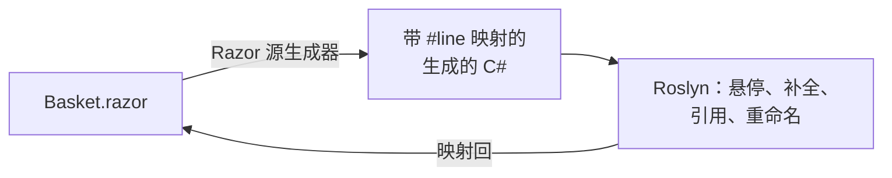

# Blazor 与 Razor

SharpLsp 在 VS Code 中编辑 Razor 文件时，使用的是它处理 C# 时的同一个 Roslyn 引擎。这涵盖 [Blazor](https://learn.microsoft.com/zh-cn/aspnet/core/blazor/?view=aspnetcore-10.0) 组件（`.razor`），以及 ASP.NET Core 的 [Razor Pages](https://learn.microsoft.com/zh-cn/aspnet/core/razor-pages/?view=aspnetcore-10.0) 和 [MVC 视图](https://learn.microsoft.com/zh-cn/aspnet/core/mvc/views/overview?view=aspnetcore-10.0)（`.cshtml`）。

标记中的 C# 可以获得悬停、补全、诊断、导航和重命名：`@` 表达式、`@code` 块、事件处理程序和 `@bind` 值。其周围的 HTML 则由编辑器的 HTML 支持处理。



## Razor 文件中可用的功能

| 功能 | 你可以获得 |
|---|---|
| 悬停 | 光标下 C# 的 Roslyn 悬停信息，包含签名和 XML 文档，并标注在 Razor 文本的对应范围上 |
| 补全 | `@` 表达式和 `@code` 块内的 Roslyn 补全。所有编辑都落在 Razor 文件中，补全添加的 `using` 会变成一行 `@using` |
| 签名帮助 | 调用内部的参数帮助 |
| 诊断 | 显示在引发问题的 Razor 行上的 C# 错误和警告。整个解决方案的扫描也包含 Razor 文件 |
| 转到定义 | 从标记跳到声明，例如跳到 `@code` 块中的方法。在 C# 中，组件的定义就是它的 `.razor` 文件：`MapRazorComponents<App>()` 会转到 `App.razor` |
| 引用与高亮 | Razor 文件中的每一处使用。编译器隐藏的脚手架代码会被排除在外 |
| 重命名 | 重命名 `@code` 块中的字段或成员时，标记中的每一处使用都会被重命名。对纯标记的重命名会被拒绝 |
| 语义高亮 | 文件中 C# 的 Roslyn 分类。标记则由编辑器的 Razor 语法着色 |
| 折叠与大纲 | 多行元素和 `@code` 块可以折叠。大纲列出指令和元素，每个 `@code` 块的成员嵌套在其下 |
| 链接编辑 | 在组件中，开始标签和结束标签一起重命名 |

结果永远不会指向生成的代码。文件中生成的 C# 里的位置，总会映射回它的 Razor 文件。

Razor 文件永远不会把 `using` 报告为多余。标记通过生成的 C# 根本不需要的 using 来解析组件标签，而 [`_Imports.razor`](https://learn.microsoft.com/zh-cn/aspnet/core/blazor/tutorials/movie-database-app/part-1?view=aspnetcore-10.0#components_importsrazor-file) 和 `_ViewImports.cshtml` 中的 using 服务于与它们同级及下级的文件。C# 文件，包括组件的 `.razor.cs` 代码隐藏，仍然会报告它们。

## 标记中的 HTML

- **VS Code**：元素和属性补全以及 HTML 悬停来自 VS Code 内置的 HTML 语言服务。SharpLsp 会带着文件的 HTML 视图转发请求，这正是 VS Code 的 [Embedded Programming Languages](https://code.visualstudio.com/api/language-extensions/embedded-languages) 指南所描述的模式。SharpLsp 自己的条目排在最前面。
- **Zed**：Zed 没有内置的 Razor 语言。从 Zed 的扩展注册表安装 Razor 扩展后，SharpLsp 会附加到该扩展定义的 `Razor` 语言。
- **其他 LSP 客户端**：对于 `.razor` 和 `.cshtml` 文件，语言 id 是 `razor`。请将 SharpLsp 与 HTML 语言服务器配合使用来处理标记。

## 工作原理

SharpLsp 从不重新实现 Razor。从 .NET 6 起，[Razor 编译器作为 Roslyn 源生成器运行](https://learn.microsoft.com/zh-cn/aspnet/core/release-notes/aspnetcore-6.0?view=aspnetcore-10.0#razor-compiler-updated-to-use-source-generators)，C# sidecar 的设计时构建会像 `dotnet build` 那样原样运行它。

生成器把每个 Razor 文件转换为 C#。它把每一段 C# 片段原样复制到生成的文件中，并用指向 Razor 文本的[增强 `#line` 指令](https://github.com/dotnet/csharplang/blob/main/proposals/csharp-10.0/enhanced-line-directives.md)将其包裹。

SharpLsp 依据这些指令构建双向映射，并在两侧核对每个片段的文本：

1. Razor 位置上的请求会映射到生成的 C#。
2. Roslyn 在那里作答，与处理 `.cs` 文件时完全一致。
3. 每个答案都会映射回 Razor 文件。

编译器隐藏的脚手架中的位置没有 Razor 文本，因此永远不会到达你这里。



标记来自编译器公开的[中间表示](https://github.com/dotnet/razor)。它驱动折叠、大纲和链接编辑，并构建 VS Code 的 HTML 服务所读取的 HTML 视图。

## 支持的项目

| 文件 | 说明 |
|---|---|
| `*.razor` | 一个 [Razor 组件](https://learn.microsoft.com/zh-cn/aspnet/core/blazor/components/?view=aspnetcore-10.0) |
| `_Imports.razor` | 面向所在文件夹及其下级每个组件的指令 |
| `*.cshtml` | Razor Page（`@page`）、MVC 视图、分部视图或布局 |
| `_ViewImports.cshtml` | 面向所在文件夹及其下级每个页面和视图的指令 |
| `_ViewStart.cshtml` | 在每个视图之前运行的代码 |

- **应用**：使用 Blazor Server 或 Blazor WebAssembly [呈现模式](https://learn.microsoft.com/zh-cn/aspnet/core/blazor/components/render-modes?view=aspnetcore-10.0)的 Blazor Web App（`dotnet new blazor`）、独立的 Blazor WebAssembly 应用、Razor Pages 或 MVC 应用，以及提供共享组件的 [Razor 类库](https://learn.microsoft.com/zh-cn/aspnet/core/razor-pages/ui-class?view=aspnetcore-10.0)。
- **项目 SDK**：`Microsoft.NET.Sdk.Web`、`Microsoft.NET.Sdk.BlazorWebAssembly` 和 `Microsoft.NET.Sdk.Razor`。
- **已验证**：在 [.NET 10](https://devblogs.microsoft.com/dotnet/announcing-dotnet-10/) SDK 上的 ASP.NET Core 10，包括全新的 `dotnet new blazor` 应用。
- **net8.0 与 net9.0**：这些项目通过同一个源生成器编译 Razor，因此应该可以工作，但尚未验证。
- **不支持**：早于 .NET 6 的项目（不使用源生成器编译 Razor），以及 .NET Framework 上的 ASP.NET MVC 5、Web Pages 和 Web Forms。

## SDK 版本

Razor 生成器来自构建你的项目的 SDK。如果没有 `global.json` 固定版本，那它就是你所安装的最新 SDK。

Roslyn 只能加载为其自身版本或更早版本构建的生成器。SDK 10.0.303 的生成器可以加载到 SharpLsp 捆绑的 Roslyn 中，但 SDK 10.0.401 的生成器需要更新的 Roslyn。因此，使用 10.0.401 构建的项目其 Razor 文件没有 C# 功能，不过标记功能仍会工作。[Issue #399](https://github.com/Nimblesite/SharpLsp/issues/399) 跟踪让所有 SDK 都能正常工作的修复。

在修复之前，请[安装 SDK 10.0.303](https://dotnet.microsoft.com/download/dotnet/10.0)，并在解决方案旁边的 `global.json` 中固定它：

```json
{
  "sdk": {
    "version": "10.0.303",
    "rollForward": "latestPatch"
  }
}
```

## 尚不支持

进度在 [issue #397](https://github.com/Nimblesite/SharpLsp/issues/397) 中跟踪。

- **组件标记**：组件标签、组件参数、`@bind-X` 以及 `@onclick` 等指令属性上的悬停、定义、补全、引用和语义着色。
- **Razor 诊断**：编译器自身的 `RZ` 诊断，例如未知组件。
- **标记帮助程序**：`asp-for` 等[标记帮助程序](https://learn.microsoft.com/zh-cn/aspnet/core/mvc/views/tag-helpers/intro?view=aspnetcore-10.0)元素和属性上的悬停与补全。
- **F#**：Razor 的代码语言是 C#，因为 Razor 编译器只生成 C#；但 Blazor 应用可以引用 F# 库。针对从 Razor 使用的 F# 类型的悬停、补全和定义，以及让 F# 重命名覆盖 Razor 中的使用，都在计划之中。
- **编辑**：格式化、选择范围、代码操作、内嵌提示、CodeLens，以及从 Razor 位置发起的调用层次结构和类型层次结构。
- **并置文件**：对 [CSS 隔离](https://learn.microsoft.com/zh-cn/aspnet/core/blazor/components/css-isolation?view=aspnetcore-10.0)（`.razor.css`）和并置的 `.razor.js` 文件的识别。
- **运行时**：Blazor WebAssembly 调试和热重载。

## 失败行为

- **没有投影**：如果项目不运行 Razor 生成器，其 Razor 文件就没有 C# 功能。标记功能仍会作答。
- **引擎故障**：如果 Razor 引擎加载失败或处理文件失败，标记功能返回空结果，C# 功能继续工作。SharpLsp 会为每个项目记录一次失败，包含项目名称和异常类型。
- **位置上没有内容**：既不是 C# 也不是标记元素的位置不会返回任何内容，也绝不会返回错误。
- **隐私**：SharpLsp 从不记录 Razor 或生成的文本，只记录路径、范围和长度。

## Microsoft 文档

- [ASP.NET Core Blazor](https://learn.microsoft.com/zh-cn/aspnet/core/blazor/?view=aspnetcore-10.0) 和 [Blazor 项目结构](https://learn.microsoft.com/zh-cn/aspnet/core/blazor/project-structure?view=aspnetcore-10.0)
- [ASP.NET Core 的 Razor 语法参考](https://learn.microsoft.com/zh-cn/aspnet/core/mvc/views/razor?view=aspnetcore-10.0)
- [Blazor 呈现模式](https://learn.microsoft.com/zh-cn/aspnet/core/blazor/components/render-modes?view=aspnetcore-10.0)、[数据绑定](https://learn.microsoft.com/zh-cn/aspnet/core/blazor/components/data-binding?view=aspnetcore-10.0)和[事件处理](https://learn.microsoft.com/zh-cn/aspnet/core/blazor/components/event-handling?view=aspnetcore-10.0)
- [泛型组件](https://learn.microsoft.com/zh-cn/aspnet/core/blazor/components/generic-type-support?view=aspnetcore-10.0)和[级联值和参数](https://learn.microsoft.com/zh-cn/aspnet/core/blazor/components/cascading-values-and-parameters?view=aspnetcore-10.0)
- [.NET 10 中 ASP.NET Core 的新增功能](https://learn.microsoft.com/zh-cn/aspnet/core/release-notes/aspnetcore-10.0?view=aspnetcore-10.0)
- [Roslyn API 与源生成器](https://learn.microsoft.com/zh-cn/dotnet/csharp/roslyn-sdk/#source-generators)
